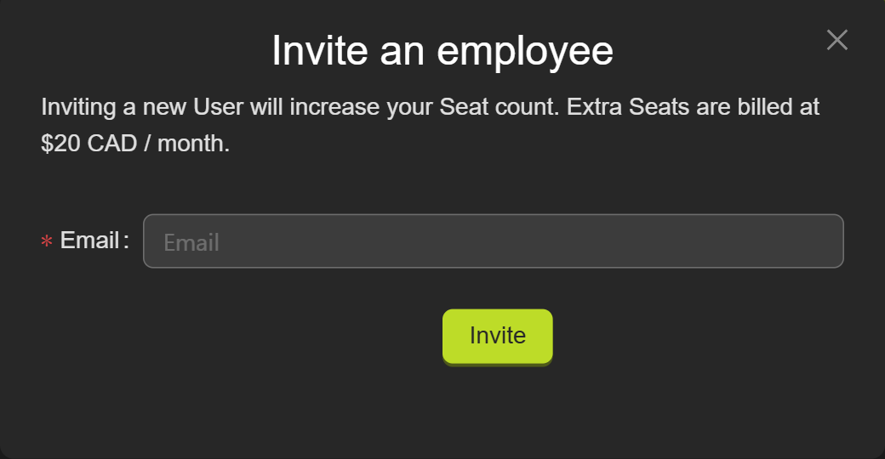

Invite people to your organisation and manage their app access as their work changes. Organisation administrators can use the **Dashboard**; your role and teams determine which users and actions are available to you.

## When to use it

Send an invitation when you know the person's email address. If you need a link that people can use to register, see [Create an organisation and manage its registration portal](./create-organisation-and-registration-portal).

## Invite someone

1. Open **Dashboard → Users → Users** or **Users → Invitations**.
2. Select **Invite a user**.
3. Enter the person's email address and select **Invite**. Review any seat information shown before sending.
4. On **Users → Invitations**, review the invitation's status and expiry. The recipient must open the invitation and complete the steps shown.

The invitation table shows who sent it, who received it, whether it was dismissed or accepted, when it was created or accepted, and when it expires. Use these fields to check whether the person needs to finish joining or needs a fresh invitation. The **User Approval Requests** table below it is for portal requests, rather than email invitations.

If an invitation has expired, ask the recipient to use a new invitation. Deleting an accepted invitation does not remove the user.

## Manage access

The **All Users** table shows each person's name, email, current-cycle usage, apps, teams, and available actions. You can filter the team column to find a group. Separate team tables also appear below the main list.

On **Users → Users**, find the person and select **Change Apps**. The dialog lists enabled apps and shows **Provide Access** for an unassigned app or **Remove Access** for an assigned app. Select the action for each app you want to change. Use **Manage Teams** in the same row to change team membership, or select users to change app access in bulk. An owner can assign or remove administrator access.

Owners can manage all teams. An administrator who is not an owner sees users in their own teams. The **Owners** and **Finance Managers** teams have special privileges. Review the descriptions on **Users → Teams** before changing their membership.

For an account labelled **Registration access only**, manage its session access in Asker Registrations. Its row has different actions from a regular Hub user.

## Disable or delete a user

Select **Delete/Disable User** in the person's row. Read the choices before proceeding:

- **Disable Account** stops access while retaining the user's data. It removes the user from their teams and removes administrator access. An administrator can reactivate the user later; their former teams and role must be reviewed and reassigned as needed.
- **Delete Forever** permanently deletes the user's data. The user will not be able to access that data with a new account.

Both choices affect the organisation's seat count. Confirm the intended person and action before continuing.

## Help a user recover access

Use **Send Password Reset Link** to send a password reset email. A password reset and a two-factor authentication reset are separate actions. For a user who cannot use their verification method or recovery code, open **Site Management → Security** and follow the **Reset MFA** prompts for an eligible member. Confirm the person's identity and enter a reason before submitting the reset.
