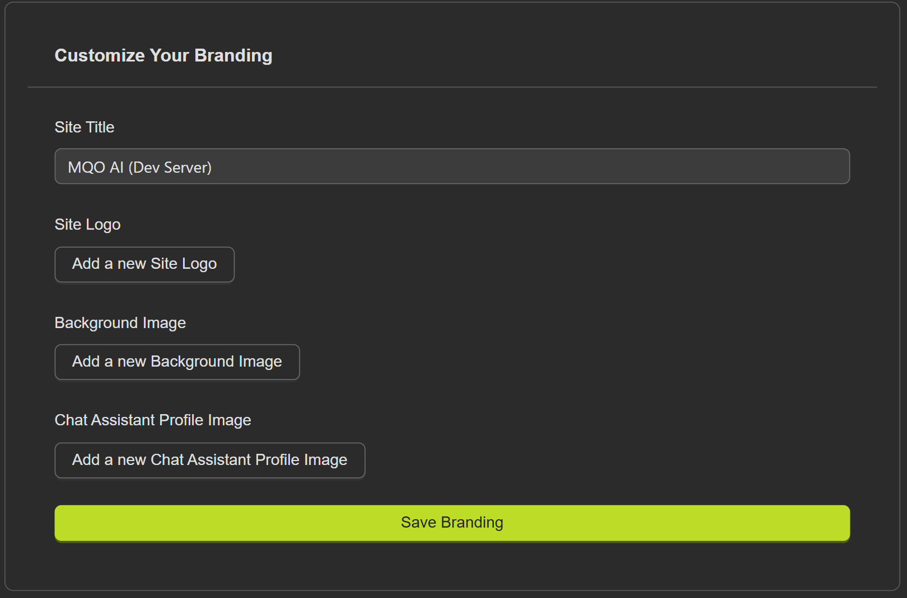

Organisation branding lets you give the Hub and Chat views a recognisable title and images. An organisation administrator can update it when custom branding is available to the organisation. If **Branding** is missing, ask your organisation administrator about access.

## Update branding

1. Open **Dashboard → Site Management → Branding**.
2. Enter a **Site Title** if you want to change it.
3. For **Site Logo**, **Background Image**, or **Chat Assistant Profile Image**, select the add or change button and choose an image. Check the preview before saving.
4. Select **Save Branding**. Wait for confirmation, then check the Hub and Chat views to see the result.

Each image field has its own preview and add, change, or remove control. Removing an image marks it for removal; select **Save Branding** to save the change. You can change one field without replacing the others.

The title is used as the browser page title. The logo appears in Hub navigation, the background image on the Hub landing page, and the assistant image in Chat. Review how each image looks in its intended location after saving.

If an upload or save fails, try again. If the result is not what you expected, reopen **Branding**, choose the intended image, and save again. Contact your administrator or support if the problem continues.
