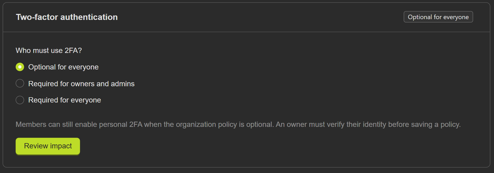

Organisation security settings let you set two-factor authentication requirements and help eligible members regain access. Owners and administrators can review them in **Dashboard → Site Management → Security**; only an owner can save a policy change.

## When to use it

Change the policy when you need to decide who must use two-factor authentication and which methods are allowed. A member MFA reset can help when the member cannot use a verification method or recovery code. A reset does not change the policy or their password.

## Review or change the policy

1. Under **Two-factor authentication**, choose who must use 2FA: **Optional for everyone**, **Required for owners and admins**, or **Required for everyone**.
2. If 2FA is required, choose **Authenticator app or passkey** or **Passkey only**.
3. Select **Review impact**. Review the covered members and those who need to complete setup.
4. If you are an owner and want to apply the change, select **Save policy**. If **Verify it’s you** appears, select **Verify identity** and complete the check. Back in the review, check your selections and select **Save policy** again. If your selections are missing or you change them, choose the policy and review its impact again before saving.

The audience choice determines who must set up a method. With **Required for owners and admins**, other members can still choose to use 2FA. With **Required for everyone**, all members are covered. **Passkey only** requires a passkey or security key for the covered group; **Authenticator app or passkey** permits either method.

The impact review helps you see who is covered and who still needs setup before you save. Changing a selection requires a new review. For example, review readiness before switching from optional to required for everyone so you can prepare members who need to enrol.

A required policy takes effect when saved. Members who do not meet it must complete the required setup to continue accessing the organisation. Making 2FA optional for the organisation does not remove a member's personal or other applicable security requirements.

## Reset a member's MFA

Use this when an eligible member cannot use their verification methods or recovery codes:

1. Confirm the member's identity.
2. In **Member MFA resets**, find the member and select **Reset MFA**.
3. Enter the reason, confirm that you checked their identity, and select **Reset MFA and sign out member**.
4. Ask the member to sign in again and set up a new verification method.

The reset removes the member's passkeys, authenticator apps, and recovery codes, and signs them out on every device. It keeps their password and the organisation policy.

You cannot reset your own MFA or an organisation owner's or platform staff member's MFA here. Organisation owners should contact MQO support for recovery. If verification is requested before a reset or policy change, complete it and return to the action.
