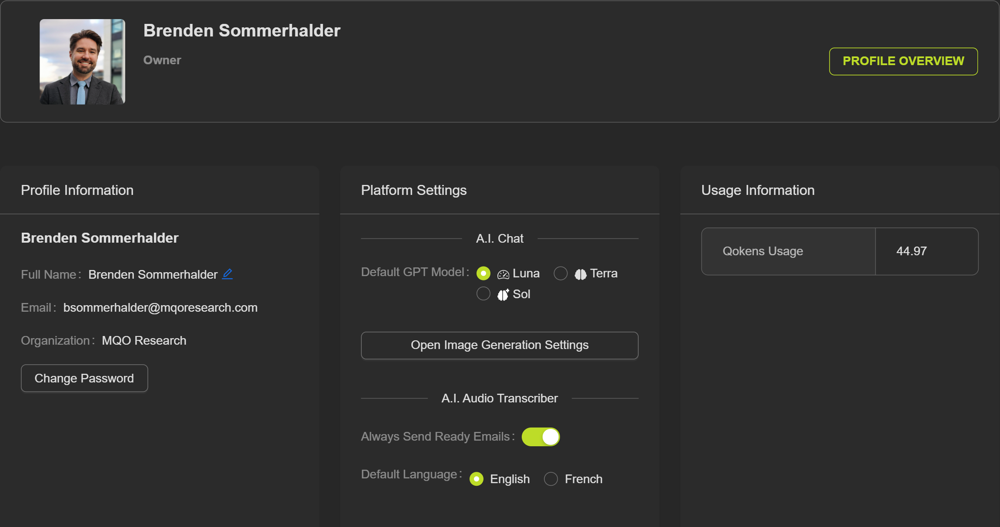

Your profile holds your account details and saved defaults, so you can start work with your preferred settings. Open **Profile** to review them.

## Update your profile

In **Profile Information**, edit your full name using the edit control beside it. The name saves through that control, separately from Platform Settings. Your email address and organisation are also shown. To change your photo, select the photo or upload control and choose a JPG or PNG image smaller than 2 MB.

To change your password, select **Change Password**, enter your current password and new password, and confirm the new password. After the change, sign in again with the new password.

## Set platform defaults

In **Platform Settings**, choose the preferences you want, then select **Save**. Select **Cancel** to discard unsaved changes.

- **Default GPT Model** sets the starting model for a new A.I. Chat.
- **Always Send Ready Emails** sets the starting email notification choice in A.I. Audio Transcriber.
- **Default Language** sets the starting language in A.I. Audio Transcriber. Choose English or French.
- **Use Binary Categorical Multi-Select Data Format** controls the format used when Content Coder builds coded output.

For example, you can change the Transcriber language for one run without changing the default for future runs.

## Set image generation defaults

Under **A.I. Chat**, select **Open Image Generation Settings**. Choose **Image Size** (square, landscape, or portrait), **Image Quality** (medium or high), **Image Format** (PNG, JPEG, or WebP), and **Number of Images**, then select **Save**. The image settings are saved in their own dialog. Some choices depend on the selected image style. For example, photographic styles use high quality, and an icon uses a square size.

To manage your sign-in methods, recovery codes, and signed-in devices, select **Manage account security** in the **Account Security** card. See [Set up two-factor authentication](./two-factor-authentication) for the setup steps.
