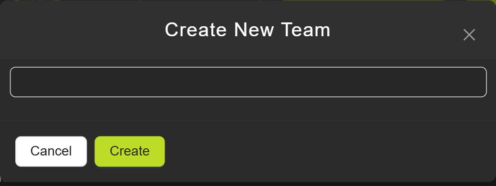

Teams group users and determine which users a non-owner administrator can manage. Open **Dashboard → Users → Teams** to view the teams available to you.

## When to use it

Use team membership to organise users and define an administrator's user-management scope. Assign administrator access separately when a user needs that role. Membership in the special Owners team grants owner access.

## Create or edit a team

The table lists each team's **Title**, **Description**, and **Actions**. Expand a special-team row to read its description. **Edit Users** opens the membership lists for that team.

An organisation owner can select **Create New Team**, enter a title, and select **Create**. On the Teams page, an owner can edit a custom team's title or description, or select **Delete Team** and confirm deletion. Deleting a team removes its users from that team.

The **Owners** and **Finance Managers** teams are special teams and cannot be deleted. The Owners team must retain at least one user. The person who created the organisation cannot be removed from that team.

## Change team membership

1. On **Users → Teams**, select **Edit Users** beside a team.
2. Find the person in the appropriate list and select **Add** or **Remove**.
3. Review the confirmation and select **Add to team** or **Remove from team**.

Owners can add users to teams. Administrators can remove users from their own teams. You can also open **Users → Users** and select **Manage Teams** in a user's row.

The membership lists distinguish people already in the team from those available to add. For example, when an administrator moves to another group, update their team membership as well as their administrator role so their management scope matches their responsibilities.

Membership in the Owners team gives a user owner access. Finance Managers can open the billing portal. Review a user's role and team membership before making a change.

## Assign administrator access

An owner can open **Users → Users**, find a user, and select **Add As Admin**. Review the confirmation and select **Add User as Admin**. To remove administrator access, select **Remove as Admin** and confirm.

An administrator who is not an owner sees users in their own teams. Check both their administrator role and their teams when their responsibilities change. The last administrator and an organisation owner cannot be removed as administrators through this action.
