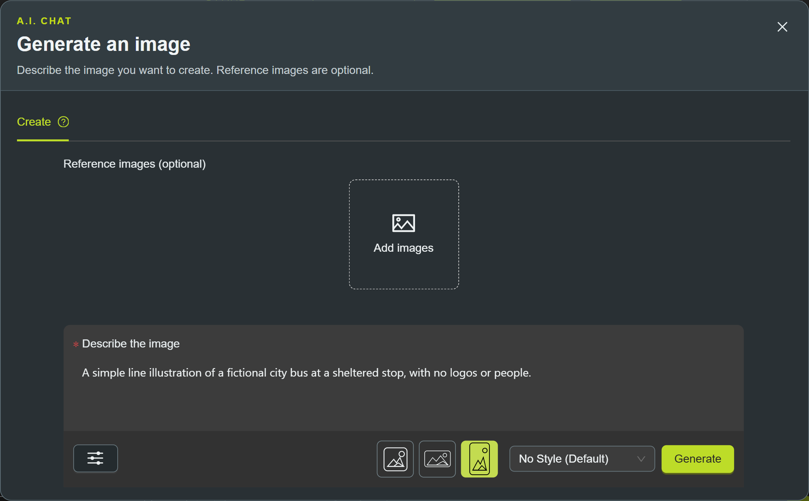
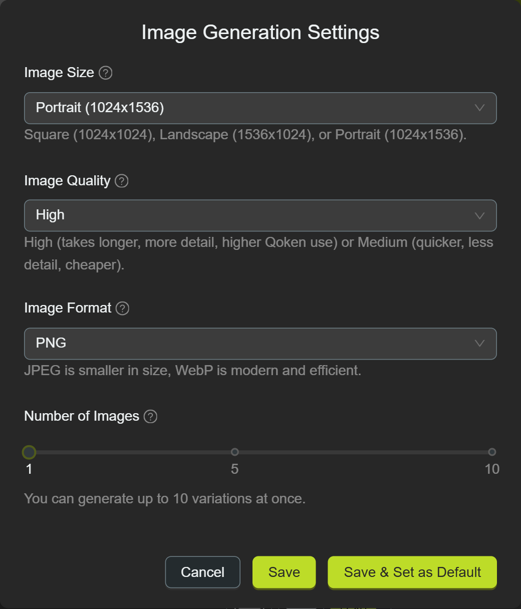

Attach an existing image for A.I. to consider, or generate a new image from a description in your chat.

## When to use each option

Attach an image when you want to ask about something you already have, such as a chart. Use **Create an image** when you want a new visual. Image generation must be available to your account.

## Attach images to a message

1. In A.I. Chat, select **Attach images** beside the message box, or paste an image into the message box.
2. Choose your images and wait for their uploads to finish. Add a question or instruction, such as asking for a description of the chart.
3. Select **Send**.

You can attach up to five images per message, each no larger than 20 MiB (shown as 20 MB in the app). The attachment control accepts PNG, JPEG, WebP, GIF, HEIC, and HEIF images. If an upload fails, retry it or remove the image before sending. Attachments in the message box belong to the current chat and are cleared when you switch chats.

## Generate an image

1. Select **Create an image** beside the message box.
2. Under **Describe the image**, explain the subject and the result you want. Optionally choose **Add images** to provide reference images.
3. Choose a style or open **Image generation settings** to adjust size, quality, format, and the number of variations. If offered, choose whether to include the current chat's context.
4. Select **Generate**. The result appears in the conversation.

The image form has three parts: optional **Reference images**, the required **Describe the image** field, and controls for the image's appearance and output. Reference images can guide the request. For example, describe the subject, setting, and intended use, such as “A flat illustration of a city bus at a stop for a survey invitation.” Select **Include current chat's context when generating the image** if the conversation contains useful background for the image.

In **Image generation settings**, **Save** applies your choices to the current image request. **Save & Set as Default** saves settings for future image requests. Check the settings for the current request before generating. The available sizes are square (1024 × 1024), landscape (1536 × 1024), and portrait (1024 × 1536). Choose Medium or High quality, PNG, JPEG, or WebP format, and one to ten images. High quality takes longer and uses more Qokens. Photographic styles require High quality; Icon style uses a square image and restricts format choices.

Choose a shape for where the image will be used, such as landscape for a wide banner or portrait for a tall page. The style changes the visual treatment, while the format determines the downloaded image file type. More variations give you more results to compare.

To download an image, open its actions and select **Download**. **Generate a variation** opens the image generator with the earlier prompt and settings so you can adjust them before generating again.

If clipboard access is denied, allow access in your browser or use the attachment control to choose a file. If a generated image cannot be retrieved, try reopening the chat.
