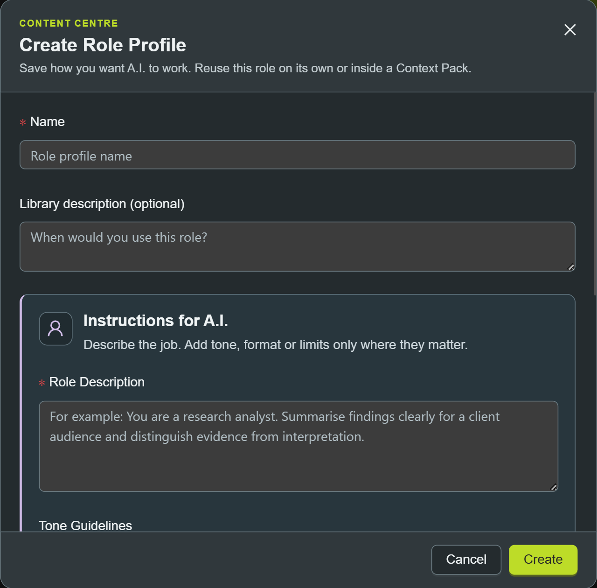
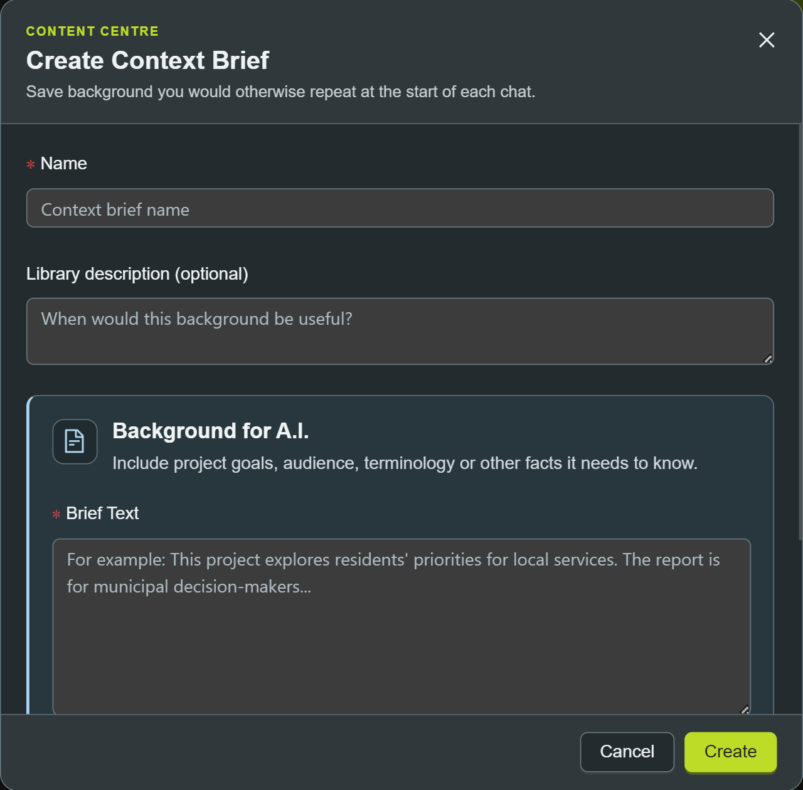
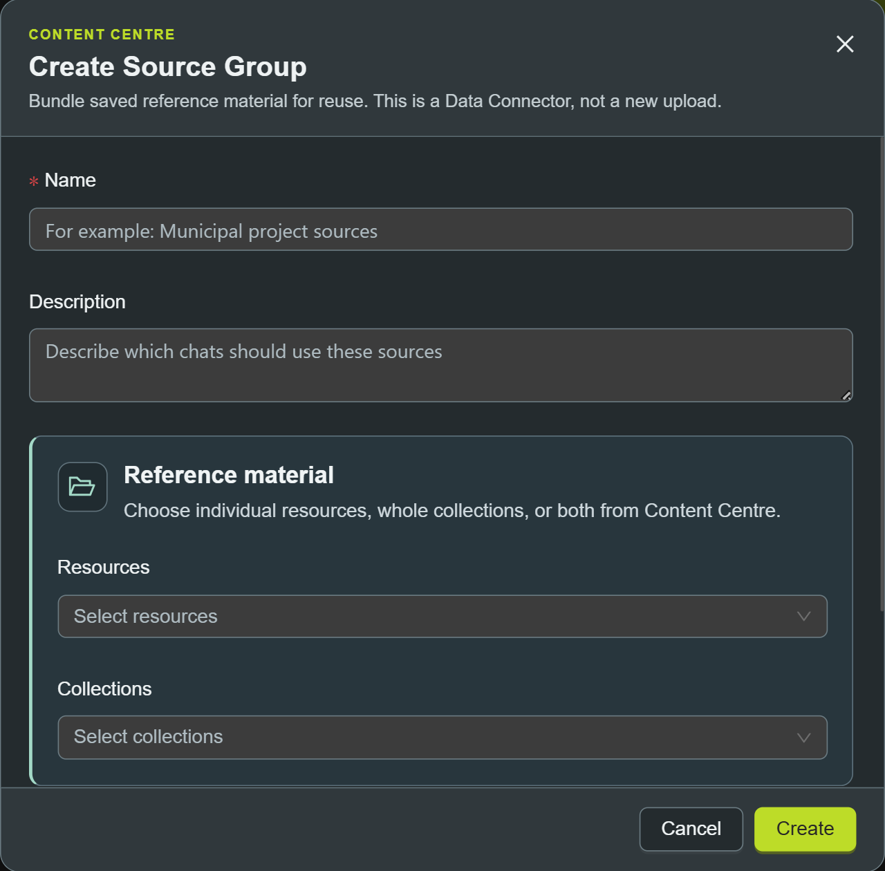
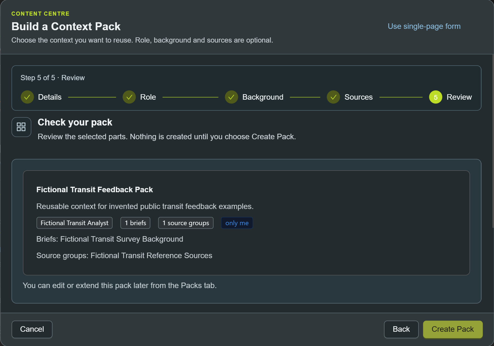

A Context Pack groups instructions, background, and sources so you can reuse them across chats.

## When to use it

Build a pack when you repeatedly give A.I. the same instructions or reference material. For example, a transit reporting pack could combine a research analyst role, a brief about who will read the report, and a source group containing survey results. For a one-off task, [choose individual context items](./use-chat-context) in the chat.

## Find the pack and its parts

Open **Content Centre → Context Packs**. The library has four tabs:

| Tab | What it holds | Transit reporting example |
| --- | --- | --- |
| **Packs** | Combinations you can add to a chat. Expand **Preview published context** to review the saved content you can access. | Transit feedback reporting |
| **Roles** | Instructions for how A.I. should work. A pack can include one role. | Transit analyst |
| **Briefs** | Background facts A.I. should know, such as the project goal, audience, and terminology. A pack can include several briefs. | Survey background |
| **Source groups** | Sets of saved Resources and Collections. The app also calls these Data Connectors. A pack can include several groups. | Survey results and route maps |

## Build a pack

Select **Build a Context Pack**. Use **Next** and **Back** to move between steps. If you already know which parts to use, **Use single-page form** puts the choices in one place.

### Details

| Field | What to enter |
| --- | --- |
| **Name** | Enter a name people can recognise when choosing context in Chat, such as “Transit feedback reporting”. |
| **Description** | Describe when to choose this pack. This helps readers distinguish similar entries in the library. |
| **Tags** | Add short labels such as “transit” and “reporting” to identify the pack in the library. |
| **Shared with** | **Only me** is the default. Choose **Specific Users** and select the intended people under **Users**, or choose the organisation option marked **(everyone)** if the whole organisation should be able to reuse it. Check recipients’ access to the underlying sources separately. |

### Role

Use **Select a role profile** to choose one saved role. Select **Create Role** if you need a new one.

- **Name** and **Library description (optional)** help people choose the right saved role.
- **Role Description** tells A.I. what job to do. For example, “You are a transit research analyst. Summarise the main themes and distinguish findings from recommendations.”
- Use **Tone Guidelines** for voice and audience, **Formatting Preferences** for the shape of the answer, and **Constraints** for boundaries. For example, ask for plain language, a table of themes, and no claims about routes outside the survey.

After saving a new role, check that it is selected in the pack before continuing.

### Background

Use **Select briefs** to choose the project facts A.I. needs. Select **Create Brief** to add background you want to reuse. Its **Name** and optional **Library description** identify it in the library. Write the actual background in **Brief Text**, for example, “This survey covers weekday riders. The audience is the transit planning team. Use ‘service frequency’ to mean buses per hour.” Select the saved brief in the pack.

### Sources

Use **Select source groups** to choose sets of reference material. To build one, select **Create Source Group**. Give it a **Name** and optionally add a **Description** of when to use it. Under **Reference material**, choose specific **Resources**, whole **Collections**, or both. For example, select the rider feedback spreadsheet as a Resource and the route maps as a Collection. Then select the saved group in the pack. To add a file that is still on your device, [save it as a Resource](./save-and-organise-resources) first.

### Review and save

Check the name, audience, role, briefs, and source groups. Each of the three types of context is optional. Use **Skip to review** if you have added enough. Select **Create Pack** to save the combination in **Packs**.

## Use and update the pack

In **A.I. Chat**, open **Chat context**, choose the pack, and add it to the conversation. Choose a snapshot when you want to keep the same version for that chat, or the latest published version when you want edits to be available there. A chat can use only one active role. See [Use context in a chat](./use-chat-context) for the attachment and replacement controls.

To update a pack you own, return to the **Packs** tab and select **Edit** on its entry. Review its audience and selected parts before saving. Use **Preview published context** to confirm what is saved. If a saved source is missing, check whether it is still in Content Centre and whether the person using the pack can access it.
