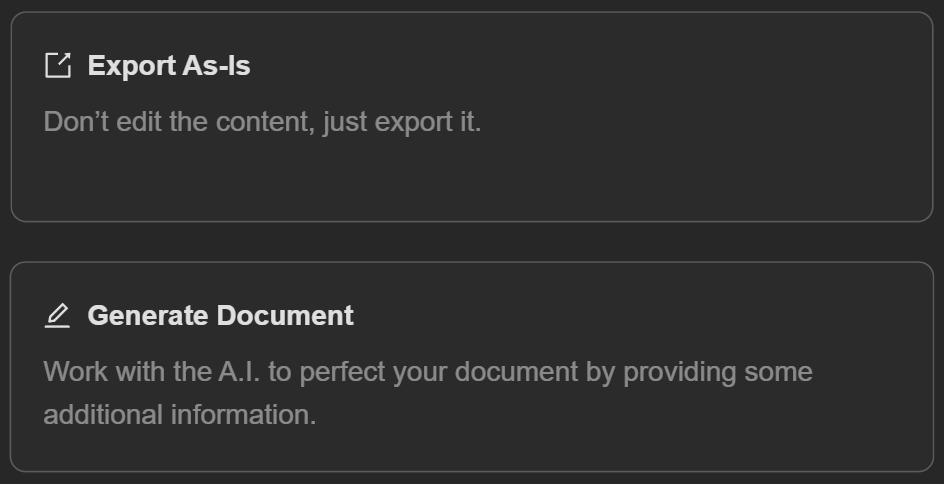
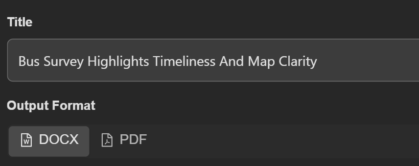

Create a document from a chat or an A.I. response when you want to turn the conversation into a file you can review or share.

## When to use it

Use this workflow to export chat content, for example as a briefing. To review proposed changes against an existing Word file and choose which to accept, use [Document Workspace](./work-with-a-document).

## Create the output

1. Open the chat. To use the chat, open **More chat actions** and select **Create a Document**. To use one A.I. response, select **Generate Document** beneath that response.
2. Select an available template and choose **Next**. The template type determines the available output formats.
3. Enter or review the **Title**, select an **Output Format**, and choose **Next**. A DOCX template offers DOCX or PDF; a PPTX template offers PPTX or PDF.
4. Choose **Export As-Is** to export the content without requesting changes, or choose **Generate Document** and enter **Generation Instructions**. For example, ask for a short briefing organised by theme. You can also add a purpose, audience, and tone.
5. Select **Generate**. When the preview opens, select **Download** and review the downloaded file, including its content and formatting.

## Choose the output and instructions

The template supplies the document's layout and determines the formats offered. Choose DOCX or PPTX when you need to continue editing in Word or PowerPoint, or PDF when you need a PDF copy. **Title** names the output. Enter your own title or use **Refresh** to request another suggestion.

**Export As-Is** uses the selected content without asking A.I. to edit it. **Generate Document** reveals the required **Generation Instructions** and optional **Purpose**, **Audience**, **Tone**, and **Document Type** fields. These describe what to make and who will use it. For example, request “Summarise the discussion under three themes and list unanswered questions,” set Audience to “Project team,” and Document Type to “Brief.”

The preview may look different from the downloaded file. Creating the document does not send it to another person.

## If something goes wrong

If **Next** is unavailable, select a template or complete the title and format. If **Generate** is unavailable, select a mode and, for **Generate Document**, enter instructions.

If the app says generation may still be processing, wait a few minutes and check your chat before trying again. If you see **Discard draft and check chat**, choose it to close the form and return to the chat. This discards the settings and instructions you entered in the form.

If the app gives a specific error, follow its guidance and check the template and instructions. If a download fails while the preview is open, retry the download from the preview. Contact support if the problem continues.
