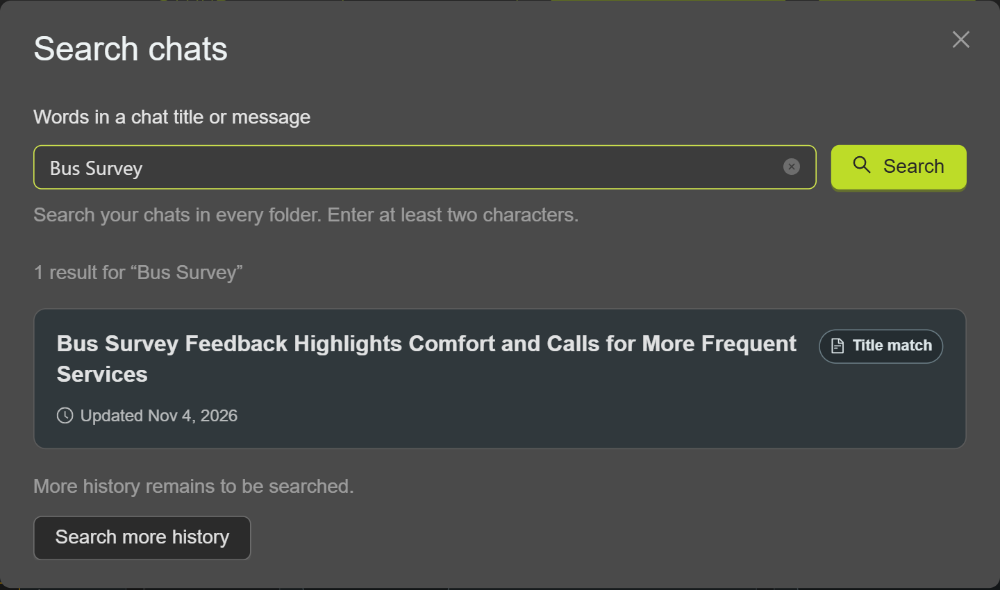
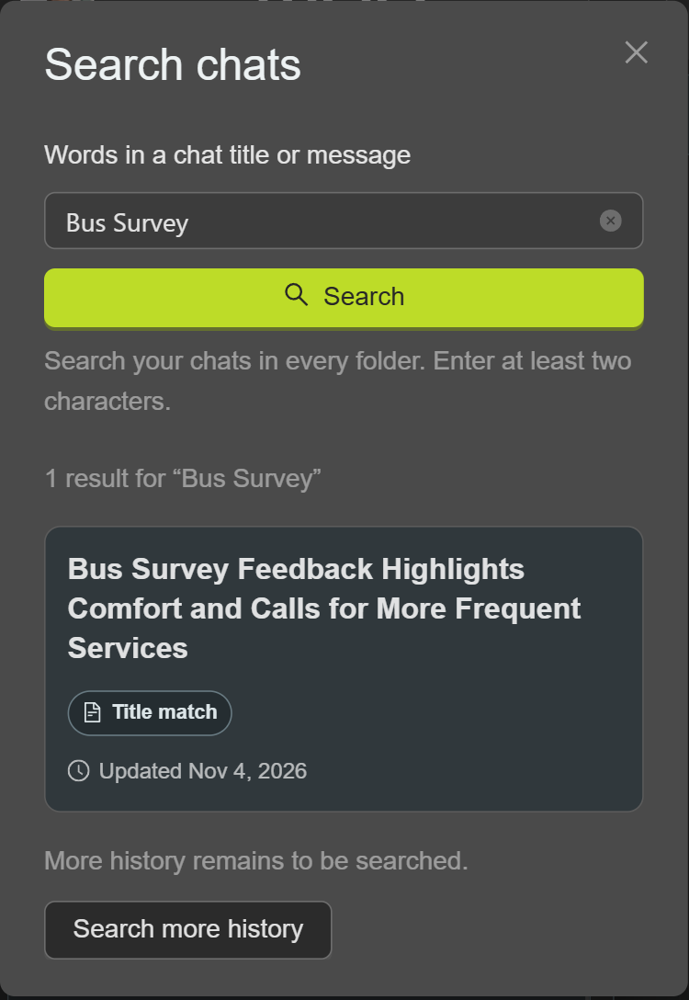
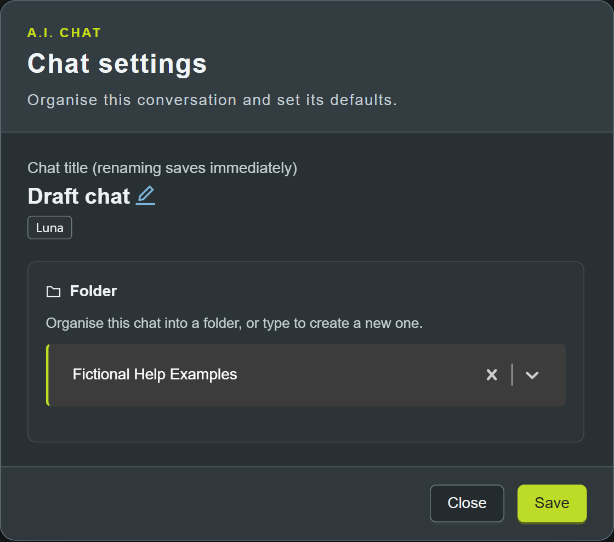

Use the Chats pane to find earlier conversations and keep related work together in folders.

## Find your way around the Chats pane

The pane brings recent chats and folders together. Select a chat to open it, or open a folder to browse related conversations. **Search chats** searches across folders, while **Select chats** opens actions for working with several conversations at once.

## Search your chats

1. In **A.I. Chat**, open the Chats pane and enter at least two characters in **Search chats**, such as a project name or a phrase from a message.
2. Select **Search**. Results can match a chat title or message text. A message result shows an excerpt.
3. Select a result to open the conversation. If **Search more history** appears, select it to continue looking through older chats.

Desktop search example:

Phone search example:

Search covers your chats in every folder. If the page says some content could not be searched, results may be incomplete. Try again if the search fails or is busy.

## Rename and file a chat

Open a chat and select the edit icon beside its title. Enter a name and confirm it. You can also open **More chat actions**, select **Chat settings**, and rename it there. A title change in Chat settings saves immediately.

To place a chat in a folder:

1. Open the chat and choose **More chat actions**, then **Chat settings**.
2. Under **Folder**, select a folder or type a new folder name.
3. Select **Save**.

In **Chat settings**, the title can be edited at the top and saves immediately. The model tag identifies the model used by the chat. Choose or clear **Folder**, then select **Save** to apply that folder choice. Analysis Chats also show **Use Reason by default**, which you can save for that conversation.

To create a folder from the sidebar, select **New** beside **Folders**. To move several chats, choose **Select chats**, select the conversations, and choose **Move**. You can also drag a chat into a folder.

To remove a folder, open its actions and select **Delete Folder**. Its chats move to the chat history list.

## Copy or delete a chat

Open **More chat actions** and choose **Copy Contents of Entire Chat** to copy the conversation's text to your clipboard. Paste it where you need it.

To delete a conversation, open **More chat actions**, select **Delete**, and confirm. Deleting a chat cannot be undone, so check the conversation before confirming. To delete several chats, choose **Select chats** in the Chats pane, select them, and select **Delete**.
