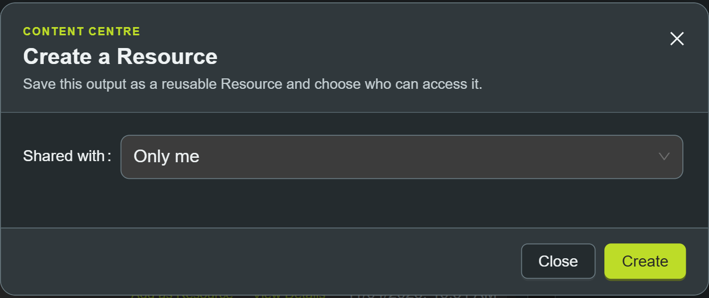

Content Centre lets you save Hub outputs and files so you can find and reuse them later.

A **Resource** is saved material, and a **Collection** groups related Resources. For example, you might collect reports for a project before starting an Analysis Chat.

## When to use each option

Save an item from **Output Stream** when it appears there. Upload a file under **Resources** when the material is already on your device. Use a Collection to group related saved items.

## Find your way around Content Centre

**Output Stream** lists outputs from Hub tools. **Resources** holds saved material and uploaded files, and **Collections** groups items for reuse. Select items to reveal actions for saving, grouping, or starting an Analysis Chat. Filters help you switch between material you own and material shared with you.

## Save a Hub output as a Resource

1. Open **Content Centre** and select **Output Stream**.
2. Select the output or outputs you want to save.
3. Select **Add selected as Resources**.
4. Choose who can access the Resources under **Shared with**, then select **Create**.
5. Open **Resources** to find the saved items.

## Upload a file

1. In **Content Centre**, select **Resources**, then **Add Content**.
2. Choose a file using the upload options.
3. Check its **Resource Title** and sharing settings. Add more files if needed.
4. Select **Upload Files** and wait for the upload to finish.

The upload form lists each chosen filename and a **Resource Title**. Use a descriptive title to recognise the item later, and remove a file from the list if you selected it by mistake. **Shared with** sets the audience: **Only me**, your organisation (everyone), or **Specific Users**. If you choose **Specific Users**, select the intended people in **Users** before uploading.

**Only me** keeps a new Resource private to you. You can choose your organisation or specific users when the available sharing options fit your task. Check the audience before saving.

## Organise and share

To create a Collection from saved Resources, select them in **Resources**, open **Actions**, and choose **Create a collection from selected**. Enter a title, choose who can access the Collection, and create it. To add items to an existing Collection, choose **Add to existing collection**.

For example, save three survey reports as Resources, then group them in a Collection named for the project. A Collection's sharing choice sets who can access the Collection. Review the sharing of its Resources as well when others need to use them.

To share a Resource later, open its actions and select **Share**. Choose the intended audience and confirm. Check that recipients can access the material they need before relying on it in a shared workflow. Starting a chat from a Resource does not itself share the Resource with other people.

Use the **Mine** and **Shared** filters to narrow your library. You can select saved Resources or Collections and start an Analysis Chat from them. See [Start an Analysis Chat](./start-analysis-chat).

If an item is still processing, wait until it is ready before adding it to a Collection or using it for analysis. If you cannot find an item, check the filters and whether it is shared with you.
