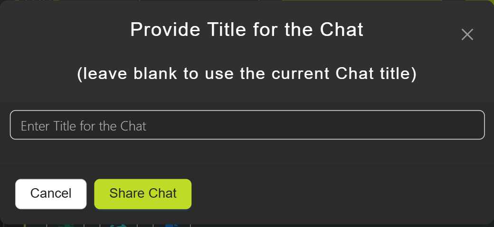

A public link lets you share a chat or one A.I. response with a recipient outside the conversation.

## When to use it

Use a link for content you are comfortable making available to people who receive it. Check the chat or response, including any attachments, before creating the link. For saved material you want to share with a selected audience in your organisation, see [Save and organise resources](./save-and-organise-resources).

## Choose what to share

The chat action creates a public link to the conversation. The response action shares one A.I. response. Choose the response when it contains what the recipient needs on its own. The title in the sharing dialog labels the shared view; it does not choose the audience or send the link.

## Share a chat

1. Open the chat and select **Create public link** in the chat toolbar. On a phone, open **Tools** and choose **Create public share link**.
2. Enter a title for the shared view, or leave it blank to use the current chat title.
3. Select **Share Chat**. The Hub creates a link and attempts to copy it to your clipboard.
4. Open the copied link and check the shared view before sending it to anyone. Creating a link does not send it for you.

## Share one response

1. Find the A.I. response you want to share and select **Share** beneath it.
2. Enter a title, or leave it blank for the default title. Select **Share**.
3. Check the copied link and its shared view before sending it.

Treat the link as sensitive: people who receive it may be able to open the shared content. Do not rely on an organisation Resource audience setting to restrict a public link. If you need to share confidential material, use an approved sharing method for your organisation.

## If a link does not work

If the message link cannot be copied automatically, the Hub displays **Message URL**, where you can select the link and copy it. If the chat link is not in your clipboard, check your browser's clipboard permission. A link may already have been created even if copying failed; contact support if you cannot retrieve or safely share it.

If a recipient cannot open a link, check that the complete link was copied and ask them to try again. If it still fails, contact support. Do not assume that deleting the chat or changing a Resource audience revokes a link.
