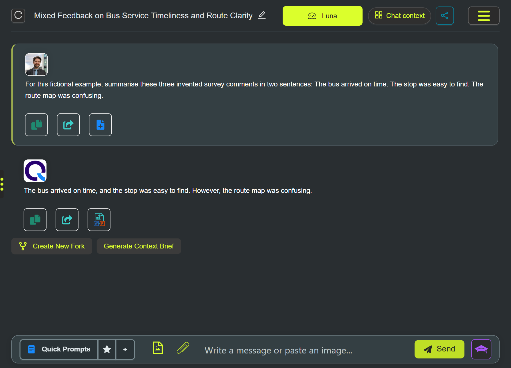

A.I. Chat lets you ask questions and refine ideas or drafts through a conversation.

Review its answers and check important facts before using them.

## Find your way around A.I. Chat

The Chats pane holds recent conversations and folders. Select **New Chat** there to start a separate conversation. The main area shows the selected chat, with its model and chat actions above the conversation and the message box below it. On a phone, open **Tools** to reach chat actions.

The message box is where you write a request, attach an image, or insert a Quick Prompt. The conversation above it contains your messages and the A.I.'s responses. Actions beneath a response let you work with that individual response.

## Start a conversation

1. Open **A.I. Chat** and select **New Chat**.
2. Choose a model before sending your first message. Luna is suited to fast everyday work, Terra to complex analysis and drafting, and Sol to demanding professional tasks.
3. Type your request and select **Send**, or press Enter. Give the A.I. enough context to understand the task, audience, and desired result. For example, ask it to outline a briefing for a project team.
4. Continue the conversation with follow-up questions or corrections.

The model is fixed after the conversation has started. To use another model, start a new chat. When you change the model before sending, you may be offered the option to make it the default for new chats. Select **Yes** if you want to save that choice.

## Ask for more reasoning

Select **Reason**, or press Ctrl+Enter, to use higher reasoning for one message. Reasoning can take longer. Shift+Enter adds a new line without sending.

While an answer is being generated, type a correction and select **Steer**, or press Ctrl+Enter, to redirect it. Select **Stop** to stop generation and keep the partial answer.

For a longer-running Analysis Chat, **Chat settings** also offers **Use Reason by default**. Save that setting to use Reason when sending messages in that conversation.

## Add background or files

To add reusable instructions or reference material, select **Add context** in a new chat, or **Chat context** in an existing chat. See [Use context in a chat](./use-chat-context).

To ask questions about files, choose **Upload files and start** to prepare an [Analysis Chat](./start-analysis-chat). To review proposed changes to a Word document, choose **Work with a document**. See [Work with a document](./work-with-a-document).

## Find your work

Use the Chats pane to reopen or search conversations. Search can match chat titles and message text. Open **Chat settings** from the chat actions to place a conversation in a folder or create a folder.

If a message cannot be sent, check whether the chat is still opening, files are processing, or an image upload needs attention. Wait for processing to finish. If an analysis file failed, open **Analysis settings**, remove the failed file, and add it again before sending. For a failed image attachment, use **Retry upload** or **Remove image**.
