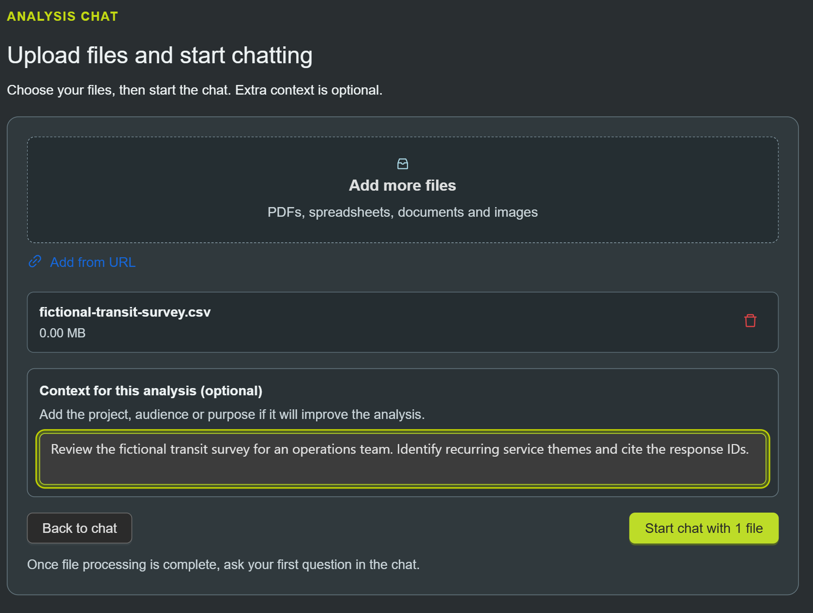
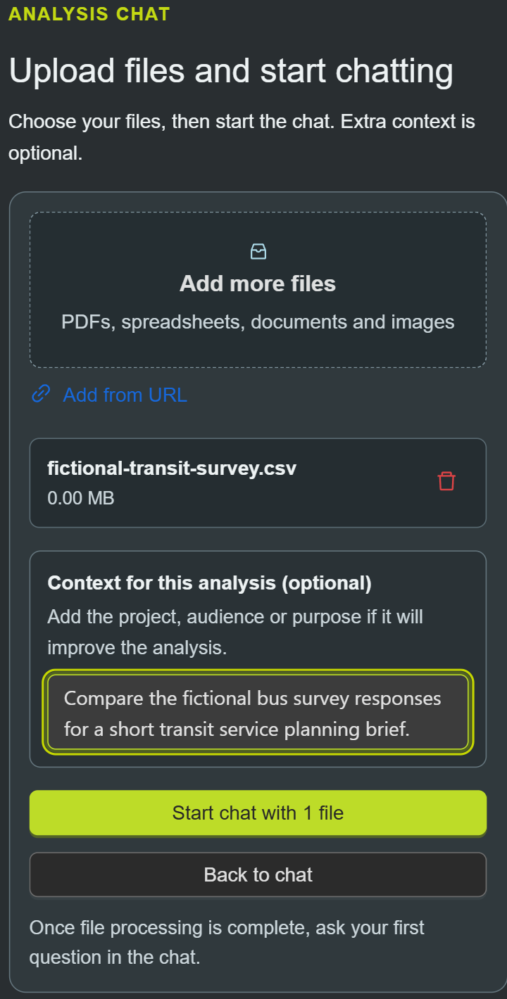

Analysis Chat brings files or saved work into a conversation so you can ask questions about the material.

## When to use it

Upload files from a new chat when the material is on your device. Choose saved Resources or Collections when it is already in Content Centre. You can also start from a ready transcript or a saved Content Coder question.

## Understand the setup

The upload area lists the files selected for this chat. Review their names and remove anything you do not want to include before starting. **Context for this analysis** is optional background about the work, such as “Summarise transit feedback for the project team, noting differences between routes.” The first question can then ask for a specific result from the files.

## Upload files from a new chat

1. Open **A.I. Chat** and select **New Chat**.
2. Select **Upload files and start**.
3. Choose files or drag them into the upload area. Add more files if needed.
4. Optionally describe the project, audience, or purpose under **Context for this analysis**.
5. Select the **Start chat** button, which shows how many files you selected. Keep the page open while the files upload.
6. When processing is complete, ask your first question in the chat. For example, ask for the main themes across the uploaded reports.

**Desktop example**

**Phone example**

You can remove a file before starting. If an upload fails, retry with the selected files or remove the failed file. Successfully uploaded files are reused on retry. If the connection is interrupted while the chat is opening, check your recent chats before trying again.

## Use saved Resources or Collections

1. Open **Content Centre** and select **Resources** or **Collections**.
2. Select the material you want to use. Review its status and wait for processing to finish where needed.
3. Select **Start Analysis Chat** in the selection bar.
4. Review the selection, enter a **Chat Title** and **Purpose of the chat**, then select **Start Analysis Chat**.

The selection summary shows the chosen material and its status. **Chat Title** helps you find the conversation later. **Purpose of the chat** tells A.I. what kind of analysis you plan to do. You can optionally choose **Context Packs** for reusable guidance and background.

The new chat opens with the selected material.

## Check which files the chat can use

Open **Analysis settings** in the chat. The file list shows **File Name**, **Type**, **Status**, **Preview**, **Actions**, and **Use in chat**. Use **Add file** to bring another file into the conversation. Check each file’s **Status**. Wait for **Processing** files to become **Ready**. A ready file can be used when it is **Included** under **Use in chat**. Switch a ready file to **Excluded** if you want to keep it in the list without using it for answers. Select **Preview** to review a file, or **Images** when extracted images are available.

If a file shows **Processing failed**, select **Remove**, confirm, and use **Add file** to upload it again. Resolve pending or failed files before sending a message. On a narrow screen, scroll the file list sideways to reach the file actions and **Use in chat**.

## Start from a transcript or coding project

In A.I. Audio Transcriber history, select **Chat** for a ready transcript to open a new Analysis Chat. In A.I. Content Coder, open a question and select **Chat With Responses** to discuss its saved responses and codebook. Save your coding work before starting the chat.

## If something goes wrong

If a saved source is unavailable, check whether you still have access to it. If the connection drops while the chat is opening, check your recent chats before starting another one.
