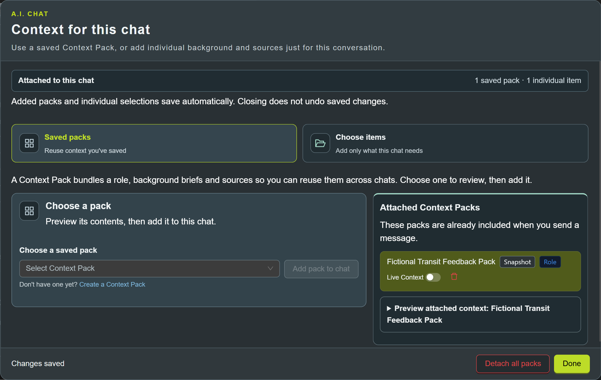
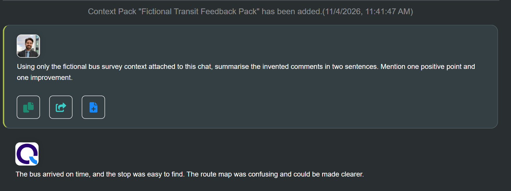

Chat context gives A.I. reusable instructions, background, or source material for a conversation.

## When to use it

Choose a saved Context Pack when you need a familiar combination of material. Choose individual items when the task needs a different mix, such as one project brief and one Resource.

## Understand the choices

- A **role** describes how A.I. should work, including its job, tone, formatting preferences, or limits.
- A **background brief** contains information A.I. should know, such as project goals, terminology, or the intended audience.
- A **source group**, also called a Data Connector, groups saved resources and collections to refer to.
- A **Context Pack** combines reusable role guidance, briefs, and source groups.

## Find your way around Chat context

**Saved packs** is for choosing a published pack. Its preview shows what the pack contains, but the pack is not added until you select **Add pack to chat**. **Attached Context Packs** lists packs already in the conversation, with a **Live version** or **Snapshot** label.

**Choose items** lets you build a mix for this chat without creating a pack. Use **Role and approach** for instructions, **Background briefs** for project facts, and the source and library selections for material A.I. can refer to. For example, choose a briefing role, a transit project brief, and a saved survey report.

## Add context

1. In a new chat, select **Add context**. In an existing chat, select **Chat context**.
2. Under **Saved packs**, choose a pack, preview it, and select **Add pack to chat**. Or open **Choose items** to select a role, briefs, source groups, individual resources, or collections.
3. Preview the choices to check what they contain. Added packs and individual selections save automatically.
4. Close the context window and continue your conversation.

The conversation records when a pack is added. You can then ask a question using that context.

You can use only one active role in a chat. If an attached pack already includes a role, remove that role-bearing pack before selecting another role.

The resource and collection choices currently show the first page of your Content Centre library. If you cannot find an item, check the library and its sharing settings.

## Choose a snapshot or the latest version

For a saved pack, turn on **Use the latest published version of this pack** to use its latest published version when you send a message. Turn it off to keep a snapshot of the version available at that time.

For an attached pack, its **Live Context** switch changes that choice. Switching it off takes a snapshot of the version available then. Check the attached pack's label before continuing.

To remove a pack from this chat, detach it in **Chat context**. This does not delete the saved pack from the library.

## Create reusable context

Open **Content Centre** and select **Context Packs** to create and manage reusable items. You can also create items beside the fields in **Chat context**. Creating an item saves it to the library. Select it separately when you want to use it in the chat.

If an item or preview is unavailable, try again and check whether it is still shared with you. Ask the owner for access if needed.
