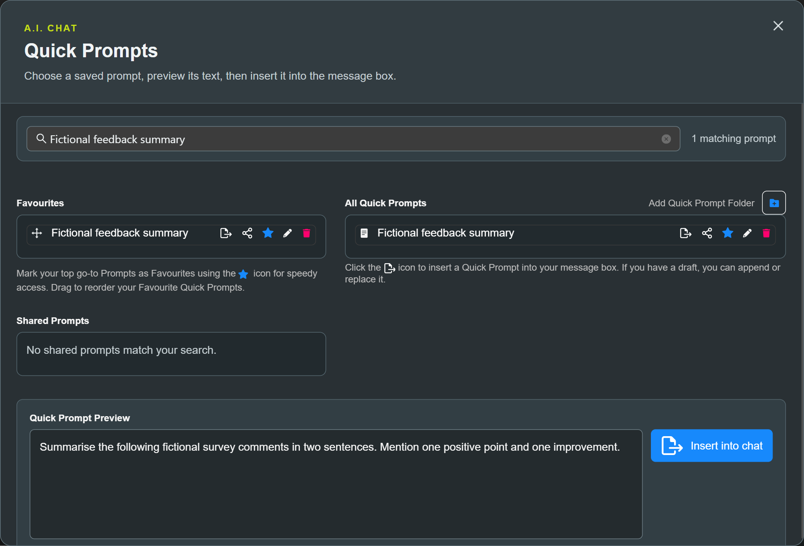
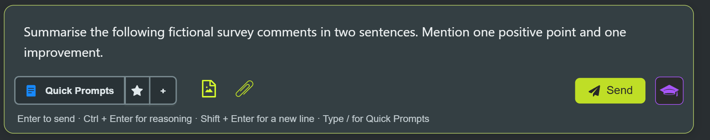

A Quick Prompt saves instructions you can insert into the message box for repeated tasks.

For example, save a request for a briefing in a preferred format, then add the details for each new task before sending. Inserting a prompt does not send the message.

## When to use it

Use a Quick Prompt for text you want to insert and adapt as a message. Use [chat context](./use-chat-context) for reusable background, instructions, or sources that you want to add to the conversation.

## Save a Quick Prompt

On a computer, select the plus button beside **Quick Prompts** in the chat composer. Enter a **Prompt Title** and **Prompt Content**, optionally select **Mark as Favourite** and a **Folder**, then select **Save prompt**.

**Prompt Title** is the name you search for. **Prompt Content** is the text inserted into the message box. **Mark as Favourite** puts a frequently used prompt in Favourites, and **Folder** groups it with related prompts. For example, name a prompt “Feedback summary” and ask for themes, supporting examples, and open questions in its content.

You can also save a message you have sent. Select **Add to Quick Prompts** on the message, enter a title, and confirm.

## Insert a saved prompt

Select **Quick Prompts** beside the message box. Search by name or text, select a prompt to preview it, and select **Insert into chat**. You can edit the inserted text before sending it.

The picker groups your starred prompts under **Favourites**, prompts others have shared with you under **Shared Prompts**, and your saved prompts and folders under **All Quick Prompts**. The **Quick Prompt Preview** shows the selected text. The search checks saved and shared prompts, so clear it to return to the full list.

The prompt appears in the message box, ready to edit or send.

If the message box already has text, choose **Append to draft** to keep your text and add the prompt below it, or **Replace draft** to replace the text. **Cancel** leaves the draft unchanged. Attachments are not changed by this choice.

You can also type `/` at the start of a line in the message box, then type a word from a saved or shared prompt. Choose a suggestion, or use the arrow keys and Enter. This replaces the slash search with the prompt and keeps the rest of your draft.

## Organise and share prompts

In **Quick Prompts**, use the star beside one of your prompts to add or remove it from **Favourites**. Drag favourites to reorder them. Use **Add Quick Prompt Folder** to create a folder. You can edit a prompt and change its folder from its edit action.

To share one of your prompts, select its share icon, choose **Share Prompt**, and select the audience. Prompts shared with you appear under **Shared Prompts**. Removing a shared prompt from your list leaves the original prompt with its owner.

If your saved or shared prompts cannot be loaded, select **Try again** in the Quick Prompts window.
