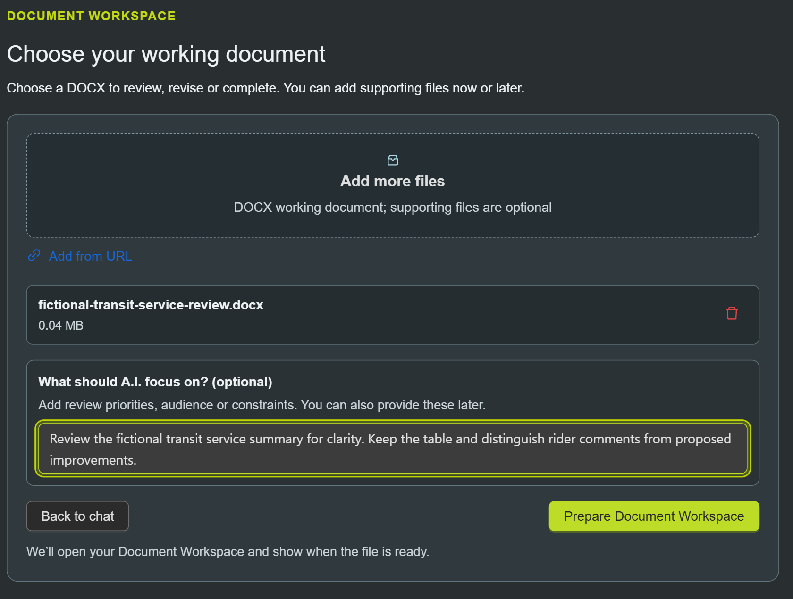
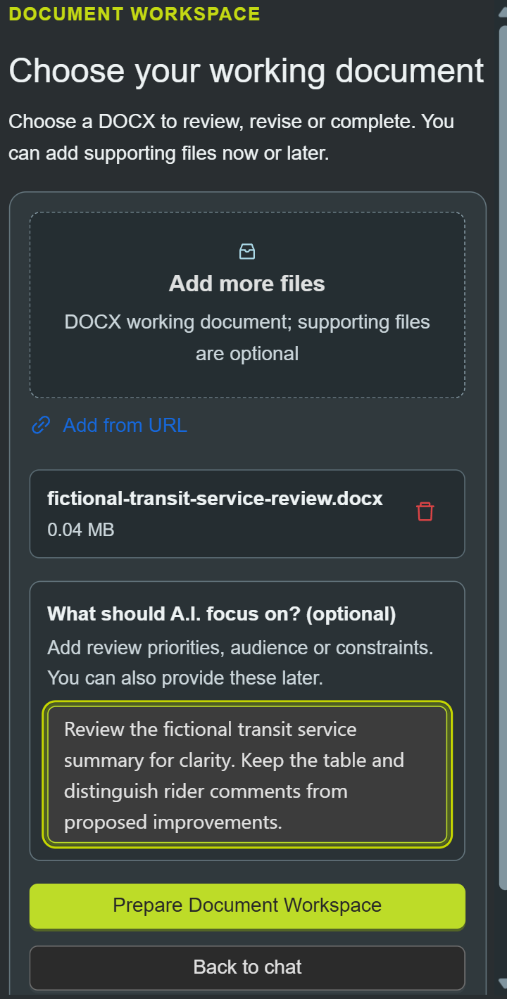

Document Workspace lets you review changes to a Word document and choose which ones to include in a new draft. Your original file stays unchanged.

## When to use it

Use Document Workspace when you already have a DOCX, such as a report that needs clearer language or a form that needs to be filled from supporting material. To turn a conversation into a new file, use [Create a document from chat](./create-document-from-chat).

## Open a workspace

1. In a new A.I. Chat, select **Work with a document**.
2. Choose the **DOCX working document** you want to revise. Add supporting files if they contain evidence or background the review needs. Use **What should A.I. focus on? (optional)** to give the audience, priorities, or constraints. For example, “Make this transit report clearer for councillors. Keep the table and distinguish riders’ comments from proposed improvements.”
3. Select **Prepare Document Workspace**. Keep the page open while files upload. When the workspace opens, wait for the working document to appear in the preview.

**Desktop example**

**Phone example**

If you already have eligible files in a chat, open **More chat actions** and choose **Create Document Workspace** or **Open linked Document Workspace**, whichever is available. If the setup form opens, enter a **Workspace name**, choose the **Working document (DOCX only)**, and select any processed **Reference files** to use as evidence. Select **Create Document Workspace**. Use **Open linked chat** in the review panel to return to the conversation.

## Find your way around the workspace

On desktop, the file list, preview, and review panel sit side by side. Drag a divider to give a panel more room. On a narrow screen, use **Files**, **Preview**, and **A.I. changes** to switch between them.

| Area | What you can do there |
| --- | --- |
| **Workspace files** | Select the **Working document** to return to the current version, check **References**, or open an earlier file from **Version history**. |
| **Document preview** | Read the selected version, move between pages, zoom or reset to fit width, select text for a request, and download that version. |
| **A.I. and proposed changes** | Write instructions, compare suggestions with the saved text, make decisions, and create a new draft from accepted changes. |

## Choose supporting references

In **Workspace files**, select **Manage references**. On a narrow screen, find it in **Files**. Choose files from the linked chat or Content Centre, or clear a selection to remove it from the workspace. Select **Save references**. The **References** list shows how many files are attached and flags any that are **Unavailable**.

For a transit report, the report itself is the working DOCX. Survey results and meeting notes can be references. A.I. can read those references when proposing changes. The references stay separate from the draft.

## Tell A.I. what to change

1. Choose the scope of the request. Highlight a passage and select **Use selection** to focus on that text. Select **Use this page** to focus on the current preview page. To ask about the document more broadly, leave the scope unset or select **Remove** beside the attached text or page.
2. Enter an instruction in **What should A.I. do?**. For example, highlight a paragraph and ask, “Rewrite this for a reader who hasn’t seen the survey. Keep the numbers and the time period.”
3. Select **Propose changes**. Each request works from the current saved version until you create a new draft.

## Review each proposed change

Check the location, compare **Current** and **Proposed**, and read **Why this helps**. If the card lists sources, expand them to see which references support the change. A confidence label is a cue for your review. Check the proposed text and its sources before relying on it.

| Control | What happens |
| --- | --- |
| **Accept** | Holds the proposed text for the next draft. |
| **Reject** | Leaves the proposed change out of the draft. |
| **Edit**, then **Accept edited text** | Holds your wording for the next draft. **Cancel edit** closes the editor without saving that edit. |
| **Ask for a rework…** | Puts a suggested instruction in the request box. Review or edit it, then select **Propose changes** to send it. |

A card marked **Needs clarification** cannot be accepted as written. Use the request box to give the missing information. Accepted changes can appear in the preview before you create a draft. If you want to highlight revised text for another request, create the draft first.

## Create, compare, and download versions

When you have accepted at least one change and any active request has finished, select **Create draft**. The button shows the next version number and the number of accepted changes. It applies the accepted changes from requests on the current version together.

In **Version history**, choose **Original**, a **Generated draft**, or an **Uploaded version** to review it. The **Download v… DOCX** button downloads the version shown in the preview. Open it in Word to check layout, tables, and page numbers. The preview can break pages differently from Word.

If you already revised the file elsewhere, select **Upload new version**, choose the revised DOCX from the linked chat or Content Centre, and select **Upload as new version**. That adds a version and keeps the original.

## If something goes wrong

- **Upload failed** before the workspace opens. Select **Retry with selected files**, or remove the failed file and choose another. Files that already uploaded are reused when you retry from the same screen.
- **Your DOCX could not be prepared** after the workspace opens. Select **Open linked chat** to check the file, then retry the upload or choose another DOCX.
- **Unavailable** reference. Open **Manage references** and remove or replace the unavailable file before requesting new changes.
- **Pending changes could not be previewed**. The workspace shows the saved version and holds accepted changes. If draft creation also fails, review the affected changes and contact support if the problem continues.
