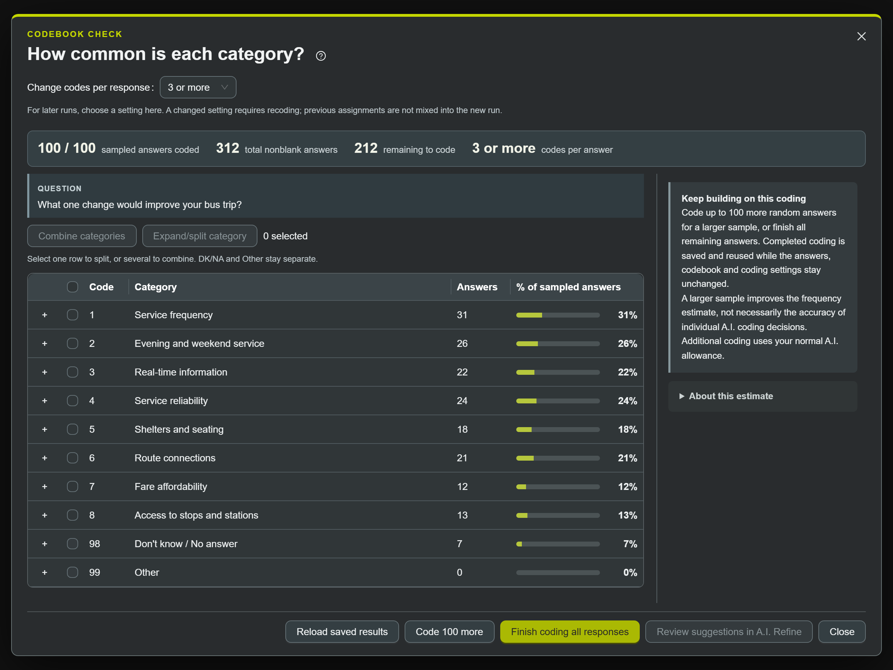

**Codebook Check** applies your codebook to a random sample of nonblank answers so you can assess the categories before coding the rest.

## When to use it

Use the check to see sample frequencies and consider suggested changes to the codebook. To review individual A.I. decisions against a blind human sample, use [human verification](./verify-coding).

## Review the check

1. Open your project and question, and generate or prepare the detailed and clean codebooks.
2. Open **Category frequency** to view the Codebook Check. A check may also open after codebook generation. If no results are available, select **Estimate category frequency** to start a check using your normal A.I. allowance.
3. Read the number of sampled answers coded, the total nonblank answers, and the category counts and percentages. The first estimate samples up to 100 nonblank answers. If the preview is partial, finish it before interpreting the percentages. Multiple categories can apply to one answer, so percentages can add to more than 100%.
4. Review any options to consider. A no-change result is also possible. Check the definitions and responses before deciding whether to make changes.
5. To review suggested changes, select **Review suggestions in A.I. Refine**. Edit the instructions there and submit only if you want to run a refinement. Opening the suggestions does not change the codebook.

For example, if 12 of 100 sampled answers (12%) receive a category, that percentage describes the sampled answers. It is not a count of every answer in the project.

A sample describes the answers checked. Do not remove a useful category just because it is rare in that sample.

## Check more answers or finish

If you want to keep your own **Codes / response** choice for a new sample, select **Use current setting and code sample**. Select **Code … more** to add up to 100 answers to the random sample, or **Finish coding all responses** to save the current codebook and code the remaining nonblank answers. New coding uses your normal A.I. allowance. **Reload saved results** opens saved results without starting new coding. If a check is interrupted, select **Resume estimate** to continue compatible saved sample work.

Compatible saved coding is reused while the answers, question, context, codebooks, and coding setting remain unchanged. If these inputs change, run a new check before relying on its estimates. You can hide a running check and return through **Category frequency** while keeping the same question open.
