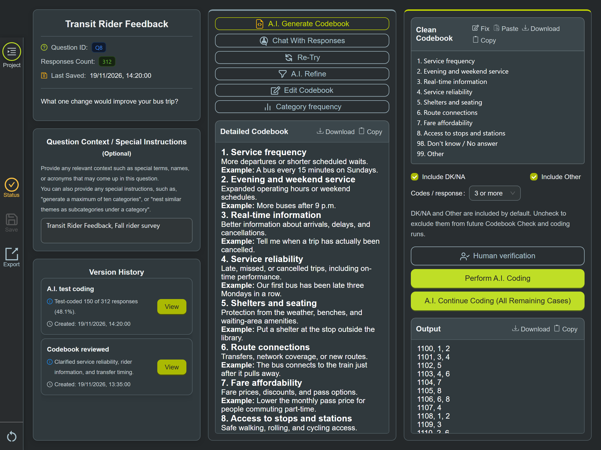

A.I. coding applies your prepared categories to responses so you can review and export the results.

## When to use each route

Run full coding when the codebook is ready for all responses. Start with a test of up to 150 nonblank responses when you want to inspect output before coding the rest. If you have already run a [Codebook Check](./check-codebook), you can finish from its sample and reuse compatible saved assignments. That route is separate from continuing a test.

## Before you start

Open the project and question. Review the question text, optional context, and clean numbered categories. If you use a detailed book, check that its definitions match the clean list. You can [reuse an existing codebook](./generate-and-edit-a-codebook#use-an-existing-codebook). Choose **Codes / response** to match how many categories an answer may need, and save your changes.

## Code the responses

1. Select **Perform A.I. Coding** for a full run, **A.I. Test Coding (codes 150 cases only)** for a test, or **Finish coding all responses** in **Category frequency** after a Codebook Check.
2. If you started with a test, review its output, then select **A.I. Continue Coding (All Remaining Cases)** when you are ready to code the rest with the same settings.
3. Wait for the operation to finish and the question to save. Read the displayed progress or error message before leaving the question.

## Review the output

Coding uses your normal A.I. allowance.

Review the **Output** and check the categories against the responses. For example, compare an answer about both wait times and staff knowledge with its assigned categories, using your definitions to decide whether the result fits. Blank answers are not sent for A.I. coding. A completed result can be exported for a question or project.

In this example, **Version History** shows that the test coded 150 of 312 responses (48.1%). The **Output** shows the assignments, and **A.I. Continue Coding (All Remaining Cases)** is available.

## Change the codebook or setting

If you change categories or **Codes / response** after coding, the existing output stays as it was. Run new coding with the updated choices before comparing or combining results. A Test Coding run cannot be continued with a different codes-per-response setting. A new Codebook Check is also needed when its inputs no longer match.

For example, if you test with one code per response and then decide that answers need multiple categories, change the setting and run a new test or coding run rather than continuing the earlier test.

## If coding stops

Read the displayed message and check the saved question before starting another run. If a Codebook Check is interrupted, use **Resume estimate** to continue compatible saved sample work. If the question says completed coding was saved but cannot be loaded, reopen the question. For other interruptions, contact support if you cannot tell whether the result was saved; do not assume a partial display is a completed result.

## Related tasks

- [Check a codebook](./check-codebook)
- [Understand Content Coder settings](./understand-coding-settings)
- [Export Content Coder results](../workflows/export-coding)
