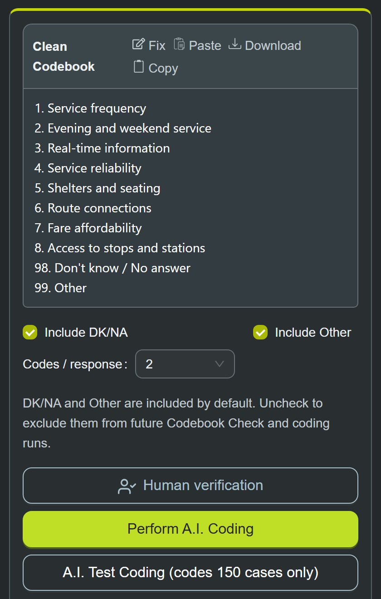
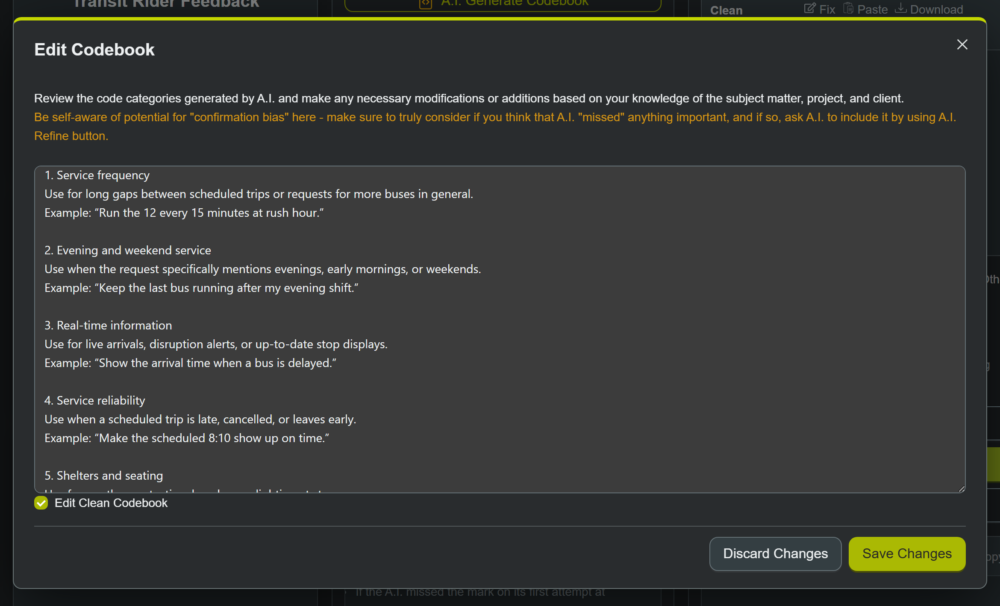
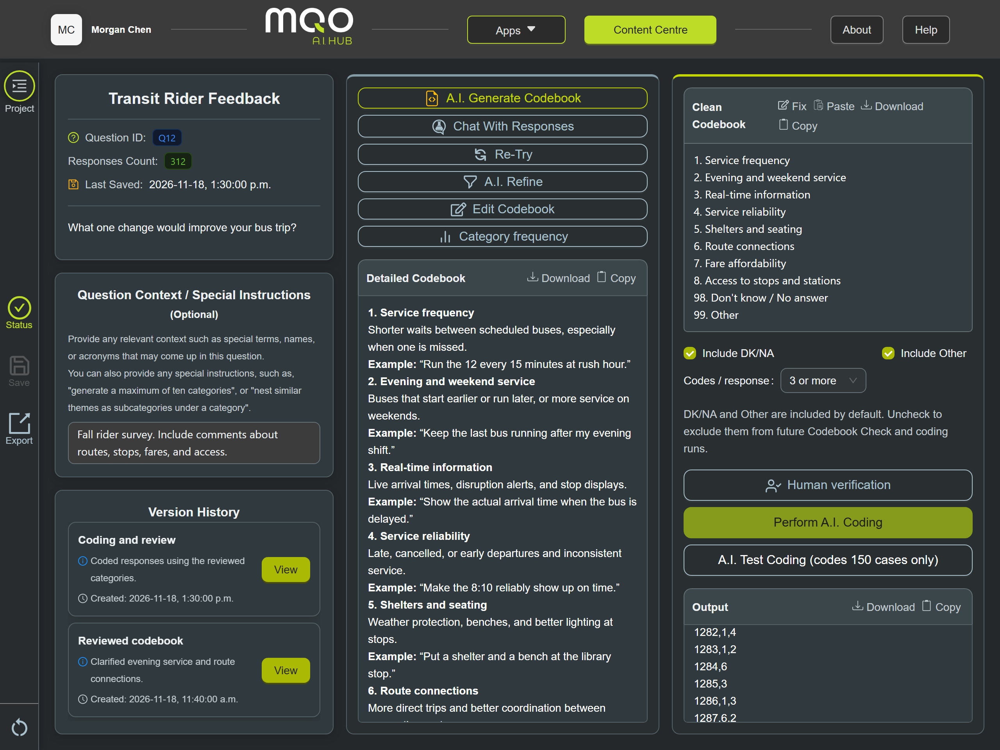
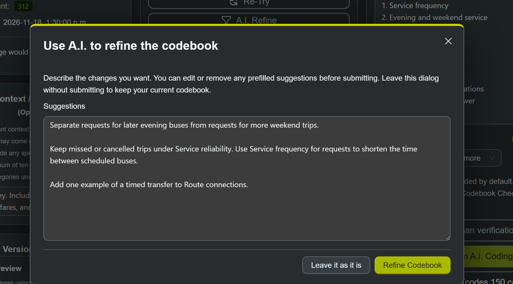

A codebook defines the categories used to code a question's responses, helping you apply them consistently.

The **Detailed Codebook** contains category descriptions and examples. The **Clean Codebook** is the numbered list used for coding. You can generate a starting book and refine it, or enter your own numbered categories in the clean book.

## Use an existing codebook

Reuse the previous wave's codebook when you're coding another wave of a tracking study. Keep the same category numbers, labels, and definitions wherever the question and its meaning are the same. Open the new wave's [imported project](./create-project-from-file) and select the matching question. You can go straight to coding after preparing your book.

### Paste a numbered category list

1. Open **Clean Codebook** and paste your existing list into the field, or use **Paste**. Put one category per line, starting with its number and label, such as `1. Service frequency`. Keep each category number unique and preserve the IDs used in earlier waves.
2. Check **Include DK/NA**, **Include Other**, and **Codes / response** against your study's coding rules. You can run A.I. coding with the clean list alone.

### Paste rules and examples into the detailed book

1. In the **Detailed Codebook** area, select **Edit Codebook**. Paste your detailed book with the number and name for each category. Add definitions, examples, and any rules for choosing between similar codes.
2. Leave **Edit Clean Codebook** selected if you want Content Coder to build the numbered list from your detailed headings. Clear it to retain a clean list you've already pasted. Select **Save Changes**, then compare the clean list with the original before coding.

For example, use **1. Service frequency** for general requests for more buses, **2. Evening and weekend service** for requests about service during those periods, and **4. Service reliability** when a scheduled trip arrives late or is cancelled. The rules and examples give A.I. more guidance for borderline answers.

### Test the book on the new wave

Select **Save** in the project sidebar. Run **A.I. Test Coding (codes 150 cases only)** and review assignments for familiar answers and borderline cases. If you change the definitions or coding settings, run a fresh test before continuing. When you're satisfied, [continue coding the remaining cases](./code-responses-and-continue). If a new theme requires a category, record the new code and the wave it was introduced in so you can interpret the trend later.

## Generate a codebook

1. Open a project in **A.I. Content Coder**, then select the question you want to code.
2. Check the question text. Add useful background in **Question Context / Special Instructions** if needed. For example, explain an acronym used in the responses or ask for a maximum number of categories.
3. Select **A.I. Generate Codebook**. Review the **Question Text** and optional **Additional Context**, then select **Generate the Codebook**.
4. Review the detailed definitions, examples, and clean category list. Check that the categories fit the responses and that their boundaries are clear before coding.

Open the definitions in **Detailed Codebook** and check their numbered counterparts in **Clean Codebook**.

For example, for a question about service improvements, a detailed category could define when an answer belongs in **Wait times** and give an illustrative example. The clean book should contain the corresponding numbered category. Check both books if you change the definition or the category name.

Generating and checking a codebook uses your normal A.I. allowance. A **Codebook Check** may open after generation to show sample frequencies and suggestions. Review its results before deciding whether to change the categories.

## Edit or refine the codebook

- To edit the detailed text yourself, select **Edit Codebook**, make your changes, and select **Save Changes** in the dialog. **Edit Clean Codebook** is selected initially, so the clean list is updated from your edited detailed book. Clear that option if you want to keep the existing clean list, then check that the two books still agree.
- To ask A.I. for a change, select **A.I. Refine**, describe the change, and select **Refine Codebook**. For example, ask it to separate comments about staff availability from comments about staff knowledge, then inspect the revised definitions and clean list. You can leave the dialog without submitting to keep the current book.
- To make another generation attempt with the current question and context, select **Re-Try**.
- For a generated detailed book, **Fix** can help correct the clean list formatting. Review the result.

The example in **A.I. Refine** asks for clearer boundaries between related transit categories.

**Include DK/NA** and **Include Other** are selected by default for a new empty book. Uncheck either choice to exclude it from future checks and coding. If you already have coding, confirm the change and run new coding before starting a new verification. Existing coding and saved reviews remain unchanged.

## Save and return to an earlier version

Use **Save Changes** in the project sidebar to save the current question, context, codebooks, coding setting, and output. You can view saved versions in **Version History**. Open a version with **View** to inspect its contents.

For a project that is not linked to a Survey, **Rollback to this Version** restores the saved question, context, codebooks, setting, and coded output. Review the version carefully before rolling back. For a linked Survey project, copy the desired codebook from the earlier version and recode instead; rollback cannot restore earlier responses.

If a save fails, keep a copy of your unsaved changes and follow the displayed message. Sign in again if your session has expired.

## Related tasks

- [Check a codebook](./check-codebook)
- [Understand Content Coder settings](./understand-coding-settings)
- [Code responses](./code-responses-and-continue)
