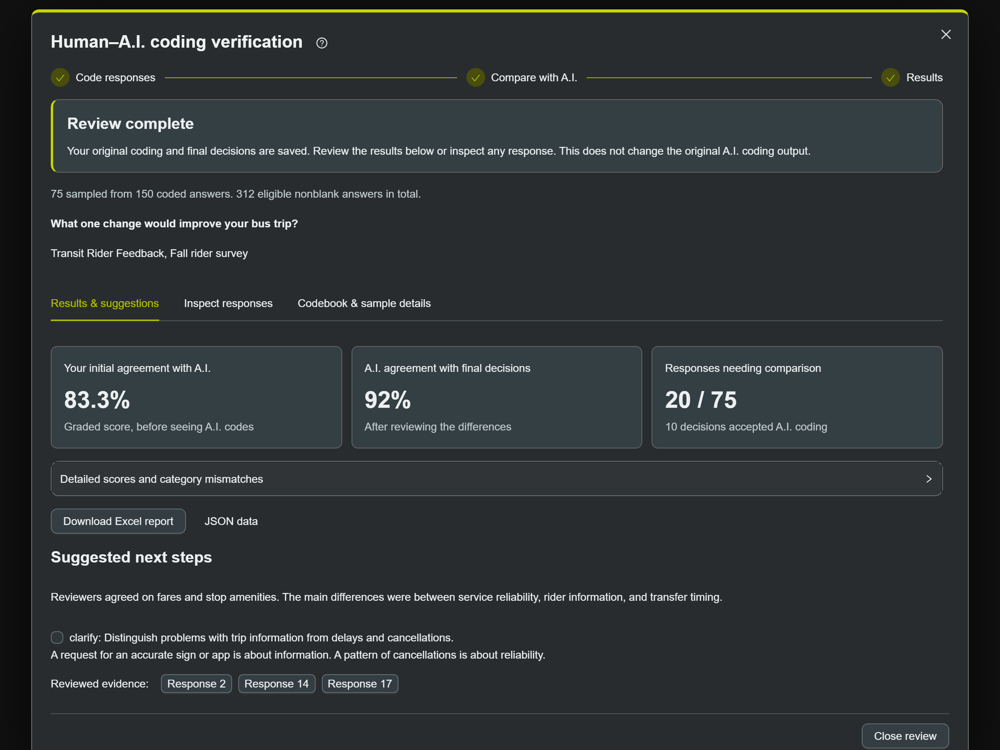

A verification report compares A.I. coding with a human-reviewed sample so you can investigate agreement and category mismatches.

Complete and lock a [human verification](./verify-coding) before using its results. The review records its decisions separately and does not automatically replace the project's A.I. coding.

## Open the results

Open the project and question, select **Human verification**, and reopen the completed review. In **Results & suggestions**, expand **Detailed scores and category mismatches**. Use **Inspect responses** to compare the original human codes, A.I. codes, and final decision for an individual answer. **Codebook & sample details** shows the saved context and sample method.

Select **Download Excel report** to keep a copy. Its sheets include the summary, category results, response comparison, reviewer notes, recommendations, and codebook. The report contains response text and reviewer notes, so handle it according to your organisation's rules.

## Start with the base

Check how many answers were eligible, how many had saved A.I. coding, how many were drawn, and how many were actually reviewed. The scores describe the submitted review responses, not necessarily every answer in the dataset. A review stopped early excludes unfinished responses; the completed subset may be biased. A small sample or a sample drawn from only part of the coded work limits what you can conclude.

Compare **Simple answers (initial)** and **Substantive answers (initial)** using the base shown for each. For example, a high score for simple answers does not by itself show the same level of agreement on substantive answers. **Simple** is a reviewer flag for separate reporting. It is not a category and does not remove an answer from the overall comparison. A result shown as **n/a** has no applicable base.

## Read the agreement scores

**Your initial agreement with A.I.** compares the blind human choices with the A.I. choices. **A.I. agreement with final decisions** compares the A.I. choices with decisions made after examining differences. Those measures answer different questions. Decisions that accepted A.I. codes remain in the final score's base, so the final score is not an independent blind comparison.

The agreement score awards one point for full agreement, half a point for other partial overlap, and zero for no overlap. For example, if 8 of 10 reviewed answers (80%) fully agree, 1 of 10 (10%) partially overlaps, and 1 of 10 (10%) has no overlap, the agreement score is 85%. The full-agreement rate is 80%. The displayed benchmark applies to the agreement score, not the full-agreement rate; it does not establish that all individual decisions are correct.

Check the rule shown for the saved review. In reviews using the three-matching-code rule, if A.I. assigned four or more codes and the reviewer chose exactly three matching codes, the response counts as full agreement. The additional A.I. codes remain visible but are not assessed as category errors for that case. Earlier reviews can use an exact-match rule instead. Compare scores across reviews only after checking their rules, samples, and codebooks.

## Examine category mismatches

For each category, **Initial mismatches / involved** compares the initial human and A.I. choices among reviewed answers involving that category. The mismatch rate uses that involved base, not the whole dataset. A base below 10 is marked small and needs particular caution. **AI missed (resolved)** and **AI extra (resolved)** compare A.I. with the final decisions, using the displayed resolved involved base. Inspect the individual answers and definitions before changing a codebook. For example, several resolved misses for a category may lead you to examine whether its definition is clear; they do not by themselves prove that the category should be removed.

An optional A.I. assessment can suggest next steps using your normal allowance. Suggestions are not applied automatically. Review their evidence before using them in **A.I. Refine**.

## If the report is unavailable

Complete and lock the review to see its results. If the Excel download fails, reopen the saved review and try again. For exceptionally long fields, use **JSON data** to download the full review data. If an earlier configuration warning appears, use the saved codebook and sample details to interpret that review, rather than assuming it represents the current configuration.
