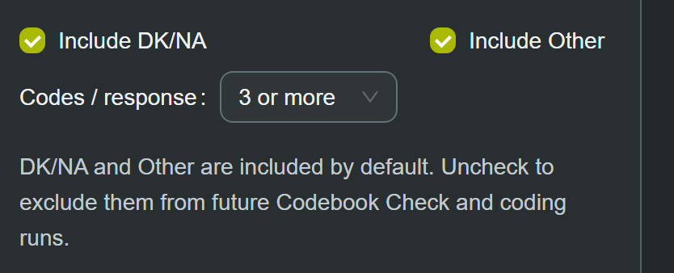

Content Coder settings determine which categories are available, how many may be assigned to an answer, and how output is represented.

Review them for each question before coding, especially when answers can contain more than one theme.

## Categories and codes per response

| Setting | Starting value or choice | Effect |
| --- | --- | --- |
| **Question Context / Special Instructions** | Optional and blank unless you add context | Supplies background and instructions for the question. For example, explain a local acronym before generating a codebook. |
| **Clean Codebook** | Generated from the detailed book or entered by you | Supplies the numbered categories available for coding. Review it alongside the detailed definitions. |
| **Include DK/NA** and **Include Other** | Selected for a new empty book | Include categories for uncertainty or no answer and for responses outside the defined categories. You can exclude either from future checks and runs. |
| **Codes / response** | New questions start at 1; saved questions retain their setting | Choose **1**, **2**, or **3 or more**. The first Codebook Check may recommend and save **1** or **3 or more**. Review the choice and explanation; you can choose a different setting. |

Find **Codes / response** below **Clean Codebook**, next to the options for including DK/NA and Other.

**1** and **2** set the maximum number of categories for an answer. **3 or more** permits more than three distinct categories when they apply. For example, choose **1** when each answer should receive a single category; use **3 or more** when an answer may cover several distinct themes.

For example, if an answer mentions both a long wait and helpful staff, a maximum of **1** permits one category. A maximum of **2** permits both, if they are appropriate in your codebook. The setting is a maximum, not a requirement to assign that many codes.

Changing categories or the codes-per-response setting does not revise existing coding. Recode with the new choices before comparing or combining results. A Test Coding run cannot continue after its codes-per-response setting changes. A Codebook Check can reuse saved work only while the answer pool, question, context, codebooks, and setting remain compatible.

## Choose how coding output is displayed

In your profile's **Platform Settings**, **Use Binary Categorical Multi-Select Data Format** controls how a new coding run writes its **Output**. It's off by default. Turn it on for binary output, then select **Save** before you start coding. The setting changes the representation of the assignments. **Codes / response** still determines how many categories can apply.

Suppose a clean book contains these three categories in order: **1. Service frequency**, **2. Evening and weekend service**, and **4. Service reliability**. Respondent 1100 receives codes 1 and 4. Respondent 1101 receives code 2.

| Setting | Output for respondent 1100 | Output for respondent 1101 | How to read it |
| --- | --- | --- | --- |
| **Off (normal)** | `1100, 1, 4` | `1101, 2` | The respondent ID is followed by the category IDs assigned. The number of values can vary by response. |
| **On (binary)** | `1100,1,0,1` | `1101,0,1,0` | The respondent ID is followed by one value for each category, in clean codebook order. **1** means assigned. **0** means unassigned. |

Use normal output to read the assigned category IDs directly. Use binary output when you want one 0/1 field per category for counting or filtering. For example, in the binary row for 1100, the last **1** represents category **4** because it's the third category in the book. A blank response can appear as a respondent ID on its own.

Changing the profile preference applies to new output. For an already coded project, select the **Export Type** you need when you [export to Excel or SPSS](../workflows/export-coding#choose-the-export-settings). Choose separately whether to include the original data columns.

## Save and check results

Select **Save Changes** in the project sidebar after editing question settings or codebooks. Wait for the save confirmation. Check the output and, when using Codebook Check, read counts and percentages with the displayed base. A sample describes the answers checked and does not establish that every individual assignment is correct.

If a save fails, keep a copy of your unsaved changes and follow the displayed message. If you change the question, context, codebook, or setting after a check, run a new check before relying on its estimates.

## Related tasks

- [Generate and edit a codebook](./generate-and-edit-a-codebook)
- [Code responses](./code-responses-and-continue)
- [Export Content Coder results](../workflows/export-coding)
