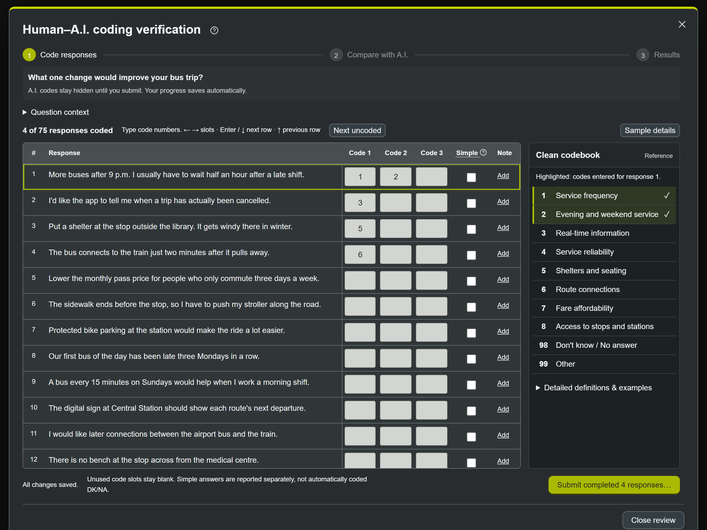

Human verification compares a blind human review with A.I. coding so you can investigate differences in a sample.

## When to use it

Use verification to examine individual coding decisions. For an initial look at category frequencies and suggested codebook changes, use [Codebook Check](./check-codebook). Verification is saved separately from the original A.I. coding.

## Start a review

1. Open the project and question, and prepare its detailed and clean codebooks.
2. Open **Human verification**. Choose 75 responses for a basic check, 100 for a larger dataset or many simple answers, or 150 for a more extensive check. A smaller coded pool is reviewed in full.
3. Select **Start blind review**. If coding is not yet available, select **Run A.I. test coding & start review**. This first codes up to 150 answers using your normal A.I. allowance.

## Code without seeing the A.I. choices

Use the numbered codebook to enter numeric codes for each answer. Leave unused slots blank. Use **Next uncoded** to move to an unfinished response. Select **Add** in the Note column when a category boundary needs explanation. Open the detailed definitions and examples when needed. Choices save as you go; check the saved status before leaving. If a choice is not saved, select **Retry save** before leaving that response. You can reopen a saved verification later.

Use **Simple** for an especially straightforward or non-substantive answer, such as “none” or “nothing”, so those cases can be reported separately. It does not assign a category or replace your numeric codes.

The clean codebook stays visible beside the responses as you enter your codes.

When ready, select **Submit coding & compare with A.I.** You may instead submit completed responses early, but unfinished rows are excluded from scores and cannot be added to that review later. A smaller or selectively completed set can bias the comparison.

## Resolve and use the results

Review differences, select final codes, and record reasons where needed. Matching answers are already resolved. For a disagreement, choose **Keep mine** or **Use A.I.**, or open **Details** to choose revised codes, add a note, or flag a codebook issue. Check the remaining-decision count as you work. Once every submitted response is resolved, select **Complete and lock review**. You can inspect agreement and category mismatches, download the Excel report, or request an optional A.I. assessment using your normal allowance. Assessment suggestions open as editable text in A.I. Refine and do not automatically change the codebook.

The review preserves its original answers and decisions. Final review decisions do not automatically replace the project’s A.I. coding. For reviews using the displayed three-match rule, when A.I. assigns four or more codes, any three matching human codes count as full agreement. The extra A.I. codes remain saved; see [Interpret a coding verification report](./interpret-verification-report) for help reading the results and the rule applied to your review.
