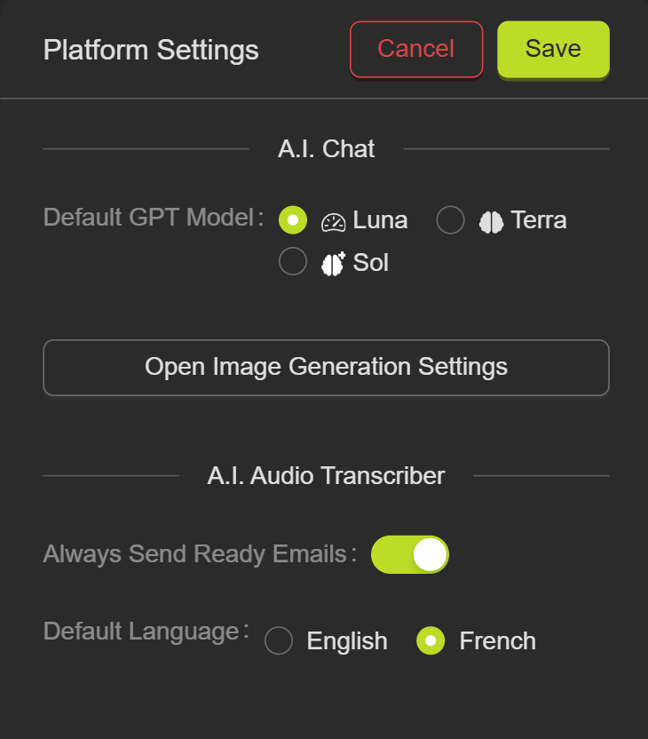

Set your transcription defaults to start new jobs with your preferred language and ready-email option.

1. Open your **Profile**.
2. In **Platform Settings**, find **A.I. Audio Transcriber**.
3. Choose English or French under **Default Language**.
4. Set **Always Send Ready Emails** to your preferred starting value.
5. Select **Save**.

When you open A.I. Audio Transcriber, these preferences set the starting language and email option. For example, set French as the default if most of your recordings are in French, then choose English on the Transcriber page for an English recording. You can change either option for the transcription you are preparing without changing the saved profile defaults. See [Transcribe audio and video](./transcribe-audio-and-video) for the remaining options.
