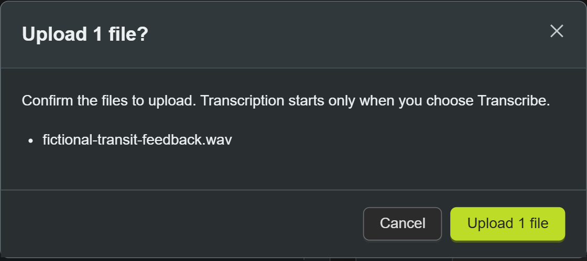
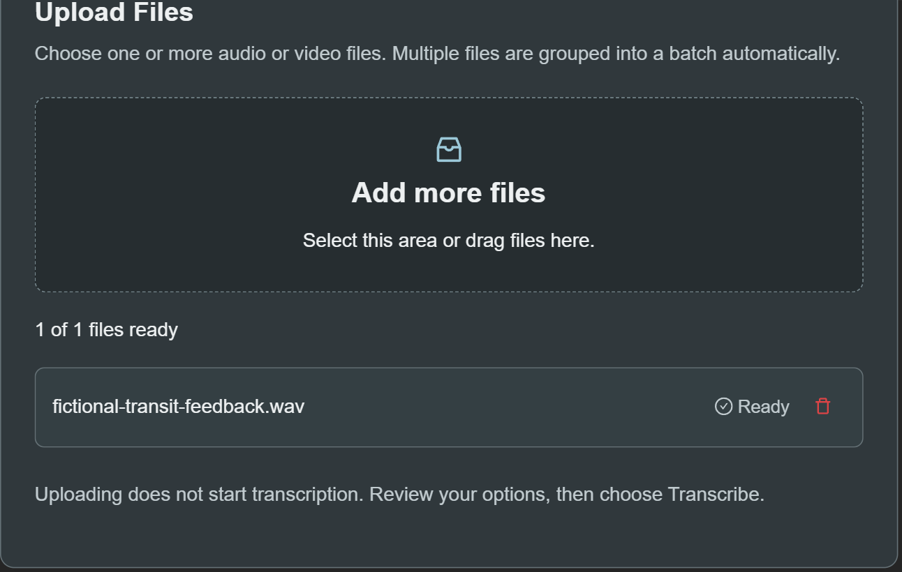
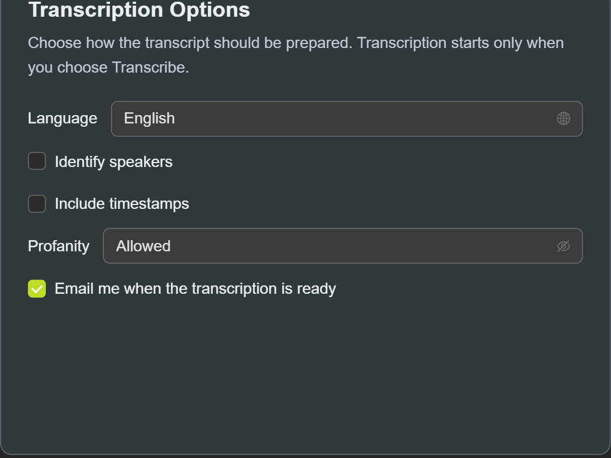

Transcribe audio or video to turn recordings into text you can read, download, and analyse.

## When to use a batch

Choose multiple files when they need the same transcription options. For example, submit a set of interviews together and give the batch a name that makes it easy to find in history.

## Before you start

You need access to A.I. Audio Transcriber. If it is unavailable, ask your organisation administrator about access.

## Upload and transcribe

1. Open **A.I. Audio Transcriber**.
2. Choose the upload area or drag audio or video files into it. Select one file for a single transcription or more than one for a batch.
3. Review the selected filenames and confirm **Upload**.
4. Wait until every file is marked **Ready**. This status refers to upload readiness, not a finished transcript. To remove a file, use the delete button beside its name. If an upload fails, remove it and choose it again.
5. For a batch, optionally enter a batch name.
6. Choose the transcription options described below.
7. Select **Transcribe**. The button shows how many files will be submitted.

Uploading a file does not start transcription. After you start it, follow its progress in **Transcription History**.

The upload confirmation lists the files you selected before sending them to the queue.

When the upload is complete, the queue shows the file as **Ready**.

## Choose transcription options

- **Language**: choose English or French. For multiple files, you can also choose **Auto Detect**. If you remove files until only one remains, select English or French before starting.
- **Identify speakers**: label speakers in the transcript and choose the maximum number of speakers, from 2 to 35. This also turns on timestamps. If a transcription fails with speaker identification on, check whether the recording uses more than one audio channel.
- **Include timestamps**: add timestamps to help locate passages in the recording. When speaker identification is off, you can set the interval in seconds. Timestamps stay on while speaker identification is selected.
- **Profanity**: choose **Allowed** or **Masked**.
- **Skip short files**: for a batch, choose whether to skip files shorter than the number of seconds you enter. For example, use this when a batch includes short test recordings you do not need transcribed. Check the expanded batch history for skipped files.
- **Email me when the transcription is ready**: request an email when processing finishes.

The options apply to every file in a batch.

## If you cannot start

Wait for uploads to finish and remove any failed uploads. For a single file, choose English or French. If starting fails, the selected files remain in the queue. Check Transcription History before trying again, especially if your connection was interrupted.

If a transcription fails with speaker identification selected, check whether the audio is mono. Convert stereo audio to mono or submit it again without **Identify speakers**. When a transcription is ready, see [Read and download a transcript](./read-and-download-a-transcript).
