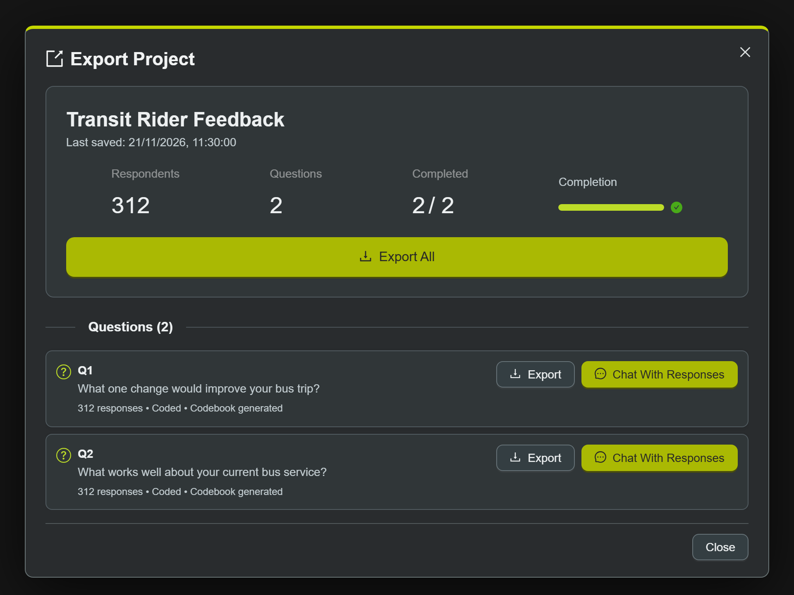
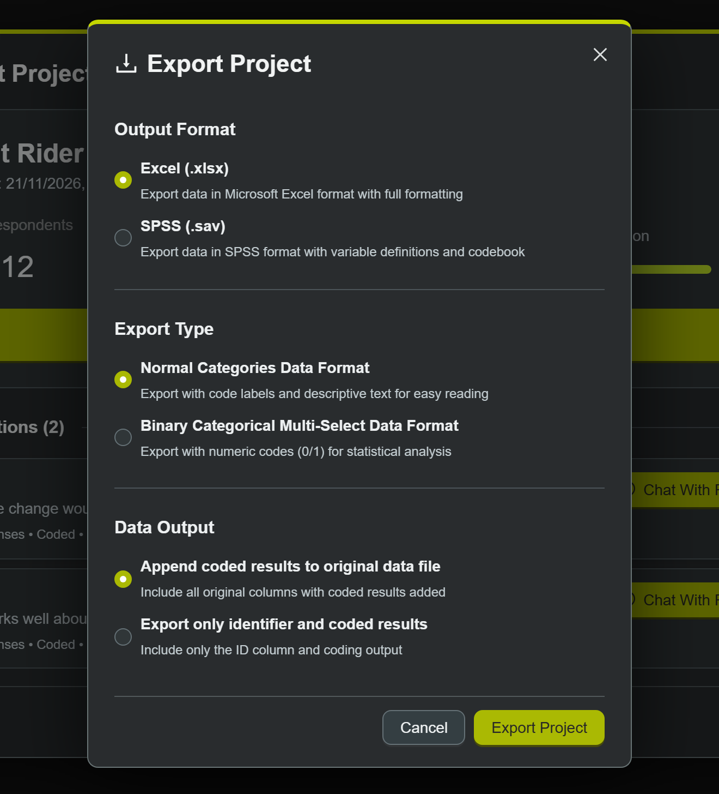

Export Content Coder results to an Excel or SPSS file for further analysis or sharing.

## When to use each option

Export a question when you need its results on their own, or the whole project when you need all questions. Choose the format your next tool can use, and review the included data before sharing the file.

## Choose what to export

1. Open your project in **A.I. Content Coder** and select **Export Project**.
2. Select **Export All** for the project, or select **Export** beside a question.
3. In the export settings, choose the file format, export type, and data output described below.
4. Select **Export Project** or **Export Question**. Open the downloaded file and check its contents.

## Choose the export settings

| Setting | Choice | Result |
| --- | --- | --- |
| **Output Format** | **Excel (.xlsx)** or **SPSS (.sav)** | Choose the file format needed for your next step. |
| **Export Type** | **Normal Categories Data Format** | Export category assignments in a readable format. |
| **Export Type** | **Binary Categorical Multi-Select Data Format** | Export category selections as numeric 0/1 values for analysis. |
| **Data Output** | **Append coded results to original data file** | Include the original columns with the coded results. |
| **Data Output** | **Export only identifier and coded results** | Include the respondent identifier and coding output. |

For example, if the categories are **Wait times** and **Staff knowledge**, binary output can represent each category with a separate 0 or 1 selection for a response. Choose binary categorical data when your analysis needs this structure. Choose identifier and coded results only when the original columns are not needed. The identifier lets you connect the coded output to the appropriate respondent row in your own analysis. Check all three choices each time, especially **Data Output**: original columns may contain information you do not intend to share.

See [normal and binary output examples](../content-coder/understand-coding-settings#choose-how-coding-output-is-displayed) for the same coded answers in both formats.

## If the export fails

If asked to sign in again, sign in and retry the export. Your saved coding is unchanged. If the export still cannot be created, check the displayed error and contact support. Check your browser's downloads if the export completes but you cannot find the file.
